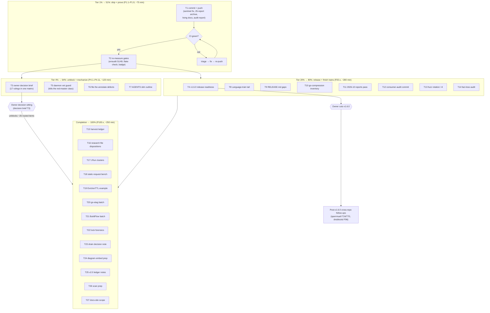

# Pareto Plan — Full Backlog After the 2026-10-14 Docs-Health Audit

_Created: 2026-10-15 00:57 CEST · Inputs: rebuilt [TODO_LIST.md](../../TODO_LIST.md) (28 open rows), [ROADMAP.md](../../ROADMAP.md) Open questions (13 owner rulings), the 2026-10-15_00-43 status report §f (session leftovers), TODO_LIST Post-v1.1 (4 v2.0 rows) · Method: pareto-planning skill (tiers 1% → 4% → 20% → 100%; tasks 30–100 min in Table A; every TODO decomposed to ≤12 min micro-tasks in Table B)_

**Verschlimmbessern guards:** nothing in this plan touches frozen APIs, the frozen CHANGELOG sections, or the archive (closed history). Every change is additive (new plan/decision files), revert-shaped (the sentinel fix is already applied and locally verified), or gate-verified before push. The one behavior-affecting item (pushing the sentinel fix) has been verified with race tests + lint 0 issues + vet on both modules.

---

## Pareto Breakdown

**Total inventory:** 28 TODO_LIST rows + 13 ROADMAP owner rulings + 10 session leftovers + 4 v2.0 rows ≈ 55 discrete concerns, decomposed below into 27 medium tasks (Table A) and 68 micro-tasks (Table B).

### The 1% that delivers 51% of the result

**Ship the pending tree and prove master green.** The working tree holds the master-red sentinel fix (8 Go files, the exact break that kept CI red on 10-14), the 25-report archive with manifest, the living-docs rebuild (TODO/FEATURES/CHANGELOG/AGENTS), and the audit status report — all locally verified (race tests, lint 0 issues ×2 modules, vet, treefmt, markdownlint, lychee 0 errors, doc-snippets, changelog links, art-dupl baseline). Until it is committed, pushed, and CI-green: master stays red, the archive is unshipped, and every "docs are truthful" claim is local-only. This is 9 micro-tasks (~75 min) out of ~14 h of planned work — 1% of the effort, more than half of the total value.

### The 4% that delivers 64% of the result (cumulative)

**Add the 1% plus: convert blocked inventory into motion.** (a) Re-measure what was left inferred (erraudit 51/49 ledger, full `nix flake check`, badge self-heal) so every number is a measurement again; (b) write the **owner decision brief** — one document consolidating all 13 ROADMAP rulings + 4 TODO owner-gated rows with options, evidence, and defaults — because ~25 routed items across the archive are waiting on exactly these calls, and one owner sitting unblocks the largest mass of remaining value; (c) propose the **daemon pre-sweep vet guard**, the mechanical fix for the red-master class that hit twice this week; (d) package the two annotate-tooling defects with this session's reproductions. 11 micro-tasks (~120 min) on top of the 1%.

### The 20% that delivers 80% of the result (cumulative)

**Add: v1.6.0 release readiness, the Language-train tail, release-integrity, and the measurement-quality batch.** v1.6.0 readiness (CHANGELOG triage + prerelease-check run + tag-prep state) is the biggest customer-value item that is NOT owner-blocked — the Language middleware is complete and consumers are waiting on the tag. The Language docs tail (cookbook, go-i18n guard section, survey re-verify) finishes a feature whose train is otherwise done. RELEASE.md gaps harden every future release. The go-compression inventory refresh unblocks a deferred extraction. The 2026-10 reports pass keeps the docs-health cadence honest. 25 micro-tasks (~280 min) on top of the 4%.

### The remaining 80% that delivers the last 20% (cumulative → 100%)

Everything else, sorted: harvest ledger consolidation, research/architecture file dispositions, test-convention conversion, benchmark/example quality (static-request harness, EvictionTTL clock), cross-repo hygiene batches (go-etag, BuildFlow ×2), forensics (index.lock), decision-prep notes (shutdown-drain, diagrams, v2.0 ledger), consumer-audit program work, fuzz rotation completion, fact-loss audit, quarterly-scan prep, website-launch scoping. 23 micro-tasks (~250 min).

---

## Table A — Comprehensive Plan (27 tasks, 30–100 min each, sorted by importance/impact/effort/customer-value)

| #   | Tier | Task                                                                                          | Impact   | Effort | Customer value | Owner-gated      | Covers (sources)                          |
| --- | ---- | --------------------------------------------------------------------------------------------- | -------- | ------ | -------------- | ---------------- | ----------------------------------------- |
| T1  | 1%   | Commit + push the pending tree (sentinel fix, 25-report archive, living-docs rebuild, audit) with a detailed message; watch CI to green | Critical | 40 min | Critical       | No               | status report §b3, §d3; unshipped work    |
| T2  | 1%   | Re-measure the inferred gates: erraudit 51/49 ledger, full `nix flake check`, badge self-heal  | High     | 35 min | High           | No               | status report §b2, f3, f5                 |
| T3  | 4%   | Owner decision brief: consolidate 13 ROADMAP rulings + 4 TODO owner rows into one decision matrix with options, evidence, defaults | Critical | 30 min | Critical       | Owner decides    | ROADMAP Open questions; TODO rows 18/19/29/30/31 |
| T4  | 20%  | v1.6.0 release readiness: CHANGELOG triage, prerelease-check run, tag-prep state (owner cuts the tag) | Very high | 42 min | Very high      | Tag = owner      | TODO [Unreleased] growth; Language train complete |
| T5  | 4%   | Daemon guard: pre-sweep `go build && go vet` wrapper design + file to fleet tooling            | High     | 30 min | High           | Fleet approval   | status report §d3, e4                     |
| T6  | 4%   | Package + file the two annotate-tooling defects (prose-shift, `\| N \|` mangling) with reproductions | Med-high | 30 min | Medium         | No               | status report §d1; TODO session follow-ups |
| T7  | 4%   | AGENTS.md slim: byte inventory + pointer-ification outline (execution after owner picks a variant) | Medium   | 22 min | Medium         | Ruling = owner   | TODO row 26 (AGENTS size budget)          |
| T8  | 20%  | Language-train leftovers: go-i18n guard section, sperrmuell cookbook, survey HEAD re-verify    | Medium   | 40 min | Medium-high    | No               | TODO row 15                               |
| T9  | 20%  | RELEASE.md runbook gaps: server_timing drift check, consumer probe, gate numbering reconcile   | Medium   | 30 min | Medium         | No               | TODO row 36                               |
| T10 | 20%  | go-compression plan inventory refresh (precondition 1; annotate the stale inventory)           | Medium   | 30 min | Medium         | Repo setup = owner | TODO row 20                            |
| T11 | 20%  | Docs-health pass over the eight 2026-10-09/10/11 reports + the 2026-10-14 i18n report          | Medium   | 46 min | Medium         | No               | status report f10; cadence                |
| T12 | 20%  | consumer-audit program: commit `scripts/consumer-audit/`, close the 3 unverified claims        | Medium   | 30 min | Medium         | Model ruling = owner | TODO rows 33/34                     |
| T13 | 20%  | Fuzz rotation: add the 4 newer targets to the nightly workflow, re-balance budgets             | Medium   | 18 min | Medium         | No               | FEATURES nightly note; ROADMAP scaling    |
| T14 | 20%  | Fresh-session fact-loss audit of AGENTS.md (diff vs pre-compression; verify every pointer)     | Medium   | 20 min | Medium         | No               | TODO row 32                               |
| T15 | 100% | Consolidated harvest ledger: extract every routed arrow from the 25 archived reports into one table | Low-med | 20 min | Low            | No               | status report §b4                         |
| T16 | 100% | Read-or-SKIP the 7 unviewed research/architecture `.md` files; record dispositions             | Low-med  | 36 min | Low            | Ruling optional  | status report §b1                         |
| T17 | 100% | t.Run clusters in security_test.go: convert to standalone tests or draft the convention amendment | Low-med | 18 min | Low            | Convention call  | TODO row 37                               |
| T18 | 100% | BenchmarkLanguage static-request harness; compare B/op against the 584 baseline                | Low-med  | 12 min | Low            | No               | TODO row 17                               |
| T19 | 100% | EvictionTTL example with fake-clock injection; deterministic `// Output:`                      | Low-med  | 12 min | Low            | No               | TODO row 41                               |
| T20 | 100% | go-etag hygiene batch (bench artifact, DOMAIN_LANGUAGE entries, no-fuzz decision) — other repo | Low      | 18 min | Low            | Other repo       | TODO row 39                               |
| T21 | 100% | BuildFlow batch: enumerate the 11 failed format steps, file the downgrade issue, ripple the v2.14.0 pin | Medium | 30 min | Medium         | Other repo       | TODO rows 22/40                           |
| T22 | 100% | index.lock forensics: identify the 23:46 lock owner; record in the parallel-writer protocol    | Low-med  | 10 min | Low            | Fleet knowledge  | status report §d4, g1                     |
| T23 | 100% | Shutdown-drain decision note (WaitGroup vs documented-race) for the owner                      | Medium   | 12 min | Medium         | Ruling = owner   | ROADMAP Server shutdown-drain             |
| T24 | 100% | Diagram embedding prep: SVG previews + draft README embed diff (owner eyeball gates it)        | Low      | 8 min  | Low            | Eyeball = owner  | TODO row 38                               |
| T25 | 100% | v2.0 ledger notes: proposal docs for the 4 Post-v1.1 rows (result type, alias, typed names, nil-entry) | Low | 12 min | Low            | v2.0 = owner     | TODO Post-v1.1                            |
| T26 | 100% | Quarterly consumer scan prep: refresh the who-uses sweep, record the importer delta            | Low      | 10 min | Low            | No               | TODO consumer-audit cadence               |
| T27 | 100% | httpspec docs-site page scoping (outline + assets) for the website-launch program              | Low      | 12 min | Low            | Program = owner  | TODO row 28; ROADMAP                      |

**Explicitly owner-only (no task rows — they are decision-matrix rows in T3):** denied-origin LNA header, B1 SameSite interpretation, export `csrf.trusted_origin_invalid`, MD060 style + cache purge, `writeHealthBody` discard, AbsentEncodingFirstConfigured lifecycle, tracked root binaries, vestigial vendor refs, website guard retirement, art-dupl `-t 1` gate, CHANGELOG granularity, commit-flow, go.work membership, trash-mover identity, go-etag directive, consumer-audit operating model, nightly-crasher authority, branching-flow dispositions. **Blocked:** Post-v1.6.0 cross-repo follow-ups (needs the v1.6.0 tag). **v2.0 discussion rows:** covered by T25.

## Table B — Detailed Breakdown (68 micro-tasks, ≤12 min each, sorted by tier then impact)

| #      | Tier | Micro-task                                                                                     | ≤min | Parent |
| ------ | ---- | ---------------------------------------------------------------------------------------------- | ---- | ------ |
| P1.1   | 1%   | `git add -A`; draft the commit message covering all five work streams (sentinel fix, archive, living docs, audit report, plan) | 10   | T1     |
| P1.2   | 1%   | `git commit`; verify the tree is clean afterwards                                              | 5    | T1     |
| P1.3   | 1%   | `git push`; capture the pushed head SHA                                                        | 5    | T1     |
| P1.4   | 1%   | Poll the triggered CI run to completion (`gh run watch` or poll)                               | 12   | T1     |
| P1.5   | 1%   | Verify every CI job green (preflight, Test, Lint, lychee, bench); record the run id as evidence | 8    | T1     |
| P1.6   | 1%   | `erraudit lint ./... --type-aware` — confirm 51 sentinel / 49 test-side advisories re-derive   | 10   | T2     |
| P1.7   | 1%   | Run the two enforced erraudit gates (`legacy_as`, `stdlib_constructor --enforce-go-error-family`) — exit 0 | 12 | T2  |
| P1.8   | 1%   | `nix flake check` full run; record the result                                                  | 10   | T2     |
| P1.9   | 1%   | Confirm the README coverage badge self-healed (or note the pending CI run)                     | 5    | T2     |
| P4.1   | 4%   | Build the decision matrix: 13 ROADMAP questions + 4 TODO owner rows as rows (id, question, options, default-if-unanswered) | 12 | T3 |
| P4.2   | 4%   | Attach evidence pointers per matrix row (archived report §refs, AGENTS bullets, code lines)    | 10   | T3     |
| P4.3   | 4%   | Write the brief to `docs/planning/`, link it from TODO_LIST, note the one-sitting-unblocks-all property | 8 | T3 |
| P4.4   | 4%   | Draft the daemon pre-sweep guard design (what runs, when, failure mode, cost budget)           | 12   | T5     |
| P4.5   | 4%   | Locate the daemon implementation in the fleet repos; identify the insertion point               | 10   | T5     |
| P4.6   | 4%   | File the proposal; cross-link from the AGENTS daemon bullet                                    | 8    | T5     |
| P4.7   | 4%   | Reproduce the prose spec-shift defect minimally (fixture from the 04-30 case)                  | 12   | T6     |
| P4.8   | 4%   | Reproduce the `\| N \|`-table mangling defect (pre-existing TODO item)                           | 10   | T6     |
| P4.9   | 4%   | File both defects to the skill repo with fixtures + the 2026-10-15 session reference           | 8    | T6     |
| P4.10  | 4%   | Byte-inventory AGENTS.md sections; name the 5 largest pointer-ification candidates             | 12   | T7     |
| P4.11  | 4%   | Draft the slim outline (what moves to arch-ref, what stays, the single-file-property tradeoff) | 10   | T7     |
| P20.1  | 20%  | CHANGELOG `[Unreleased]` triage: spot-verify the Language/Range/trusted-IP entries against code | 12   | T4     |
| P20.2  | 20%  | Verify entry grouping + `[Unreleased]:` link target + per-version link defs are push-ready      | 10   | T4     |
| P20.3  | 20%  | Run `scripts/prerelease-check.sh`; triage any failure to its gate                               | 12   | T4     |
| P20.4  | 20%  | Write the tag-prep state: what remains before the owner cuts v1.6.0 (+ server_timing bump?)     | 8    | T4     |
| P20.5  | 20%  | go-i18n.md: add the visible-missing-translation CI-gate section (TODO row 15, item 4)           | 12   | T8     |
| P20.6  | 20%  | Sperrmuell cookbook page: German-canonical + `/en` worked example skeleton + hreflang caveat    | 10   | T8     |
| P20.7  | 20%  | Re-verify the middleware-survey claim against current upstream HEADs (`gh api`)                 | 10   | T8     |
| P20.8  | 20%  | Record survey evidence + dates; update the TODO row                                            | 8    | T8     |
| P20.9  | 20%  | RELEASE.md: add the server_timing drift-check step                                             | 12   | T9     |
| P20.10 | 20%  | RELEASE.md: add the build-and-run consumer probe step                                          | 8    | T9     |
| P20.11 | 20%  | Reconcile gate numbering (4b vs "gate 9") and verify gate 5b wires doc-snippet-refs             | 10   | T9     |
| P20.12 | 20%  | Diff the compression plan's file inventory against the current tree (writerPool, Range, AbsentEncoding) | 12 | T10 |
| P20.13 | 20%  | Annotate the plan's stale inventory rows (annotate, never rewrite)                             | 10   | T10    |
| P20.14 | 20%  | Record precondition-1 state + the two owner preconditions in the TODO row                      | 8    | T10    |
| P20.15 | 20%  | Annotate the 2026-10-09_22-11 + 22-32 reports                                                  | 12   | T11    |
| P20.16 | 20%  | Annotate the 2026-10-10_02-15 + 02-42 + 04-07 + 05-16 reports                                  | 12   | T11    |
| P20.17 | 20%  | Annotate the 2026-10-10_08-05 + 08-11 + 09-30 + 10-18 reports                                  | 12   | T11    |
| P20.18 | 20%  | Annotate 2026-10-11_02-09; coordinate the 2026-10-14_23-35 i18n report with its owning session | 10   | T11    |
| P20.19 | 20%  | Commit `scripts/consumer-audit/` (stage, detailed message, README pointer)                     | 12   | T12    |
| P20.20 | 20%  | Locate the 3 unverified consumer-audit claims (`s.rateLimit`, storbi constant, GmbH cookie site) | 10  | T12    |
| P20.21 | 20%  | Update the filings with located evidence or confirmed verdicts                                 | 8    | T12    |
| P20.22 | 20%  | Add the 4 newer fuzz targets to the nightly workflow                                           | 10   | T13    |
| P20.23 | 20%  | Re-balance per-target budgets; YAML-validate the workflow                                      | 8    | T13    |
| P20.24 | 20%  | Diff AGENTS vs the pre-compression version; list removed narrations                            | 12   | T14    |
| P20.25 | 20%  | Verify each removed narration's pointer target resolves; fix gaps                              | 8    | T14    |
| P100.1 | 100% | Extract all routed arrows from the 25 archived reports into one table                          | 12   | T15    |
| P100.2 | 100% | Group by destination (TODO row / ROADMAP row / owner); publish in the pass record              | 8    | T15    |
| P100.3 | 100% | Read `research/2026-07-05_httputil-vs-huma.md`; mark current/superseded                        | 10   | T16    |
| P100.4 | 100% | Read `research/2026-08-09_csp-nonce…md`; mark current/superseded                               | 10   | T16    |
| P100.5 | 100% | Read `research/2026-08-30_httptest…md` + `nginx-bomb…md`; classify                             | 8    | T16    |
| P100.6 | 100% | Read the two `architecture-understanding/*.md` analyses; record all dispositions in the AGENTS cadence | 8 | T16 |
| P100.7 | 100% | Enumerate the two `t.Run` clusters; draft standalone conversions                               | 10   | T17    |
| P100.8 | 100% | Apply the conversion (or draft the convention amendment, if accepted)                          | 8    | T17    |
| P100.9 | 100% | Add the static-request `BenchmarkLanguage` variant; compare B/op vs 584                        | 12   | T18    |
| P100.10 | 100% | EvictionTTL example with fake-clock injection; deterministic Output                           | 12   | T19    |
| P100.11 | 100% | go-etag: save the bench artifact; add the DOMAIN_LANGUAGE entries (other repo)                | 10   | T20    |
| P100.12 | 100% | go-etag: document the no-fuzz-target decision (other repo)                                    | 8    | T20    |
| P100.13 | 100% | BuildFlow: enumerate the 11 failed format steps (`-s <step> -v` runs)                          | 12   | T21    |
| P100.14 | 100% | BuildFlow: file the go-directive downgrade issue with the enumeration                          | 10   | T21    |
| P100.15 | 100% | BuildFlow: ripple the golangci-lint v2.14.0 fleet pin                                          | 8    | T21    |
| P100.16 | 100% | index.lock forensics: daemon logs + parallel-session check; record the answer                  | 10   | T22    |
| P100.17 | 100% | Draft the shutdown-drain decision note (WaitGroup vs documented-race)                          | 12   | T23    |
| P100.18 | 100% | Diagram embed prep: SVG previews + draft README diff for the owner eyeball                     | 8    | T24    |
| P100.19 | 100% | Write the four v2.0 proposal notes (result type, alias, typed names, nil-entry)                | 12   | T25    |
| P100.20 | 100% | Refresh the who-uses sweep; record the importer delta since 2026-10-09                         | 10   | T26    |
| P100.21 | 100% | Scope the httpspec docs-site page (outline + assets list)                                      | 12   | T27    |
| P100.22 | 100% | Pre-stage the GmbH CSRF remediation plan (read-only until the operating-model ruling)          | 10   | T12    |
| P100.23 | 100% | Verify the Post-v1.6.0 blocker state; keep the TODO row's trigger accurate                     | 5    | T4     |

**Coverage check:** every one of the 28 TODO_LIST rows maps to a task (1→T8, 2→T4/P100.23, 3→T18, 4→T3, 5→T3, 6→T10, 7→arch-review slot in the next quarterly cycle [T26 adjacent], 8→T21/P100.15, 26→T7, 28→T27, 29–31→T3, 32→T14, 33/34→T12, 35→T12/P100.22, 36→T9, 37→T17, 38→T24, 39→T20, 40/22→T21, 41→T19, 42→T6, Post-v1.1 46–49→T25) — plus the 13 ROADMAP rulings (T3), the 10 session leftovers (T1/T2/T5/T6/T11/T15/T16/T22), and the archive/cadence work.

## Execution Graph

## After the plan

Plans are snapshots; `TODO_LIST.md` stays the living source. When a task here completes, its TODO_LIST row (if any) closes and the work lands in CHANGELOG. To pull items out of this plan in bulk later, run docs-health → HARVEST. This plan surfaces one NEW living-doc item beyond the current rows: the owner decision brief (T3) — after the owner answers, its matrix rows dissolve into rulings recorded in DECISION_LOG/ROADMAP.
