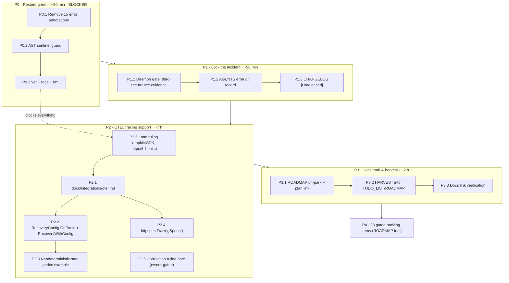

# Green Master + OTEL Tracing Support — 1% / 4% / 20% Pareto Execution Plan

- **Date:** 2026-10-23 16:12 CEST
- **Status:** PROPOSED — ready to execute; owner decisions marked below
- **Inputs:** `docs/status/2026-10-23_15-56_otel-tracing-exploration-and-red-master.md` (50-item backlog), AGENTS.md, ROADMAP.md, the 2026-10-23 OTEL exploration session
- **Hard rule:** do not verschlimmbessern. Additive only, no new root dependencies, verify each step before the next.

---

## 0. TL;DR — the real answer

1. **Restore green master now.** 15 one-line sentinel annotations (9 files) strip the concrete `*errorfamily.Error` type and break `WithContext`/`WithCause`. Master has been red and pushed since 2026-10-15 19:31. Four lines fix today's compile break; all 15 restore the documented pattern.
2. **Make recurrence mechanical, not disciplinary.** An AST guard test fails the build if any `err*`/`Err*` var is declared with an explicit `error` type. The sweep has re-landed three times; a guard is the only thing that has ever stopped it.
3. **OTEL = one doc + one hook, in that order.** The fleet already has the SDK lane (`go-appkit/otel`); httputil already has the interop affordances (Middleware alias, Pattern propagation). What is missing is (a) the canonical guide and (b) a way for standalone consumers to get exception events on spans, which requires exactly one nil-default hook in `Recovery`.
4. **No `httputil/otel` sub-module.** That would be a split brain with `go-appkit/otel`, violate "reusable libraries never take a telemetry dependency", and it is gated by an unresolved go.work policy question. Dismissed for good.
5. **No third correlation mechanism.** trace_id ↔ RequestID is the same concern as the parked dnsblockd dual-header item. One ruling: `X-Correlation-ID` echo with fallback + `correlation_id` baggage. Do not invent a parallel scheme.

---

## 1. Ground truth (verified this session)

| Fact | Evidence |
|---|---|
| `go vet ./...` fails | `example_test.go:859:30: ErrCSRFInvalid.WithContext undefined (type error has no field or method WithContext)` |
| Master is red **and pushed** | `## master...origin/master` (no ahead/behind) |
| Red since 2026-10-15 19:31 | daemon commit `0ae65b9` re-applied the sweep 14 min after deliberate revert `a6e0a12` |
| Two deliberate prior reverts lost | `28681f2` (18:47) and `a6e0a12` (19:17) — "re-revert … (second occurrence)" |
| Residue = 15 declarations / 9 files | `git show 0ae65b9`: compression.go ×2, cors.go ×1, csrf.go ×2, decompression.go ×1, language.go ×2, metrics.go ×1, ratelimit_keyed.go ×1, requestid.go ×3, server.go ×2 |
| Compile-breaking site | `csrf.go:60` `var ErrCSRFInvalid error = …` (the only sentinel with a direct `.WithContext` call in compiled code) |
| Policy already documents the rule | AGENTS.md erraudit block: *"declaring `var errX error` breaks WithContext/WithCause call sites"* |

**Blast radius if not fixed:** every consumer pinned to post-10-15 master cannot build; every task below is meaningless on a red tree.

---

## 2. Pareto decomposition

| Lever | Share of work | What it is | Why it dominates |
|---|---|---|---|
| **1% → 51%** | 4 lines (the compile break) / 15 lines (full pattern) | Remove the explicit `error` annotations on the 15 sentinels | The tree compiles; consumers unblocked; every other task becomes possible. Zero design risk — this is the documented pattern, twice reverted deliberately. |
| **4% → 64%** | ~6 items, ~4.5 h | (a) AST sentinel guard; (b) `docs/integrations/otel.md`; (c) ROADMAP un-park annotation; (d) written lane ruling; (e) HARVEST into TODO_LIST/ROADMAP; (f) daemon gate evidence | Recurrence becomes impossible (a), consumers get the actual answer (b), and this session's analysis stops evaporating (c–e). |
| **20% → 80%** | ~16 items, ~1.5 days | All of P0–P3: green master + incident lock + OTEL doc/hook/example/specs + harvest | Delivers every consumer-visible outcome of this initiative: correct traces for standalone consumers, correct docs, no red master. |
| **Other 20% → 100%** | 38 gated items, ~2–3 weeks | P4 backlog: ROADMAP fuel + owner rulings + epics (HSTS, idempotency, CSP slices, …) | Completeness. Most are decision-gated or demand-gated; they are NOT commitments. |

**Explicit non-lever:** the remaining backlog is deliberately not sequenced before P0–P3. Doing ROADMAP fuel on a red master is how we verschlimmbessern.

---

## 3. Execution graph

```mermaid
gantt
    title Critical path — day 1 (times illustrative)
    dateFormat HH:mm
    axisFormat %H:%M
    section P0 Restore green
    15 annotations           :a1, 16:20, 12m
    AST guard                :a2, after a1, 24m
    vet + race verify        :a3, after a2, 30m
    section P1 Lock incident
    daemon gate evidence     :b1, after a3, 20m
    AGENTS + CHANGELOG       :b2, after b1, 24m
    section P2 OTEL
    lane ruling              :c0, after b2, 15m
    otel.md                  :c1, after c0, 90m
    OnPanic hook             :c2, after c1, 90m
    section P3 Harvest
    ROADMAP + TODO_LIST      :d1, after c2, 60m
```

---

## 4. Comprehensive plan — tasks of 30–100 min (all TODOs)

Legend: **Imp** = importance / impact (1–5) · **CV** = customer value (1–5) · **f#** = item number in the 2026-10-23 status report section f.

### 4.1 Active plan (P0–P3)

| ID | Task | Imp | CV | Effort | Depends on | Source | Verification / DoD |
|---|---|---|---|---|---|---|---|
| P0.1 | Remove the explicit `error` annotation from all 15 sweep-residue sentinels (9 files), restoring inferred `*errorfamily.Error` | 5 | 4 | 30 min | — | f1, f2 | `gofmt -l` clean; `go vet ./...` exits 0 |
| P0.2 | AST guard test: fail if any `err*`/`Err*` var is declared with explicit `error` type | 4 | 2 | 30 min | P0.1 | f3 | Guard passes now; re-adding one annotation makes it fail (mutation probe) |
| P0.3 | Full verification: `go vet`, `go test -race ./...` (root incl. httpspec), `cd server_timing && go test -race ./...`, `golangci-lint run` | 5 | 3 | 45 min | P0.1, P0.2 | f4 | All exit 0; tree formatted |
| P1.1 | Append third-recurrence evidence to `docs/planning/2026-10-15_02-35_daemon-presweep-build-gate-proposal.md`; mark "validated by live incident (red master 10-15→10-23)" | 4 | 2 | 30 min | P0.3 | f15 | Proposal records the new incident + timeline |
| P1.2 | AGENTS.md erraudit block: record recurrence ×3, the guard file, and the canonical verdict pointer | 3 | 1 | 30 min | P0.2 | f5 | Single canonical paragraph, no duplicated policy |
| P1.3 | CHANGELOG `[Unreleased]`: sentinel fix + guard + (later) OTEL doc/hook entries | 3 | 1 | 30 min | P0.1 | — | Entry follows existing style, links valid |
| P2.5 | Record lane ruling: `go-appkit/otel` = SDK/provider lane; httputil = zero-dep hooks/contracts lane | 4 | 2 | 30 min | — | f13 | AGENTS + architecture-reference both say the same thing; ROADMAP cross-links |
| P2.1 | `docs/integrations/otel.md`: two-lane guide (bare otelhttp; go-appkit/otel), canonical ordering, gotchas (Compression writer wrap, Hijacker/Flusher, ServerTiming placement), verification snippets | 5 | 5 | 100 min | P2.5 | f9 | A consumer can wire tracing from the doc alone; every claim matched to code |
| P2.2 | `RecoveryConfig{Logger, OnPanic}` + additive `RecoveryWithConfig`; `Recovery(logger)` unchanged; hook runs before the 500 body write | 4 | 5 | 100 min | P2.1 | f10 | Tests: hook receives request + recovered value; nil hook == current behavior; `-race` green |
| P2.3 | Godoc example for the hook (deterministic boolean probes, no raw stack prints) | 2 | 3 | 45 min | P2.2 | — | `// Output:` deterministic; no testutil helpers |
| P2.4 | `httpspec.TracingSpecs()`: traceparent reaches the handler intact; absent header unchanged; wrapper preserves `Flusher`/`Hijacker` | 3 | 3 | 100 min | P2.1 | f11 | Opt-in specs run via `Run(..., WithSpecs(TracingSpecs()))`; passes against a plain handler and a wrapped chain |
| P2.6 | Correlation ruling note: `X-Correlation-ID` echo + fallback, `correlation_id` baggage, traceparent-seeded RequestID yes/no; feeds the dnsblockd item | 3 | 3 | 60 min | — | f12, f16 | Decision note in `docs/planning/`; owner question listed; no code until ruled |
| P3.1 | ROADMAP annotation: OTEL demand signal 2026-10-23, plan link, un-park wording ("parked — demand appeared") | 4 | 2 | 30 min | P2.5 | f7 | ROADMAP.md:31 no longer says "no consumer demand" |
| P3.2 | HARVEST: route active items into TODO_LIST.md, gated items into ROADMAP.md, none left entombed | 4 | 1 | 60 min | P3.1 | f14 | Every section-f item has exactly one home |
| P3.3 | Docs link verification + freshness check on touched living docs (README/AGENTS/ROADMAP/TODO_LIST) | 2 | 1 | 30 min | P3.2 | — | No broken relative links; no contradictory claims |

### 4.2 Gated backlog (P4 — all remaining section-f items)

| ID | Task | Imp | CV | Effort | Source | Gate |
|---|---|---|---|---|---|---|
| B01 | Daemon pre-sweep build gate: owner ruling + wiring decision | 4 | 3 | 30 min | f15 | owner |
| B02 | RequestID dual-header correlation (`X-Correlation-ID` echo + fallback) — implement if P2.6 rules yes | 3 | 4 | 100 min | f16 | P2.6 |
| B03 | go.work membership policy for sub-modules (ruling + doc) | 3 | 1 | 30 min | f17 | owner |
| B04 | HSTS middleware (validated `SecurityHeadersConfig` pattern) | 3 | 3 | 100 min | f18 | demand |
| B05 | HTTPS-redirect helper (`X-Forwarded-Proto`, trusted-proxy model) | 3 | 3 | 100 min | f19 | demand |
| B06 | `MaxHeaderBytes` passthrough on `ServerConfig` | 2 | 2 | 30 min | f20 | demand |
| B07 | Idempotency-key middleware design (native Store interface) | 3 | 4 | 100 min | f21 | demand |
| B08 | Shutdown-drain semantics decision + implementation | 3 | 3 | 100 min | f22 | owner |
| B09 | Nightly-fuzz workflow scaling (concurrency, matrix, inputs) | 2 | 1 | 60 min | f23 | cost appetite |
| B10 | TLS-config clone-on-write for `Server` | 3 | 3 | 60 min | f24 | design |
| B11 | Consumer-audit program as standing tooling | 3 | 3 | 100 min | f25 | owner |
| B12 | Consumer-audit operating model (3 sub-rulings) | 3 | 2 | 30 min | f26 | owner |
| B13 | Autonomous nightly-crasher authority ruling | 3 | 1 | 30 min | f27 | owner |
| B14 | `AbsentEncodingFirstConfigured` lifecycle ruling | 3 | 2 | 30 min | f28 | owner |
| B15 | Branching-flow dispositions (upstream filings vs suppression) | 2 | 1 | 60 min | f29 | owner |
| B16 | `MiddlewareFunc.Append(...)` decide-or-decline | 2 | 2 | 30 min | f30 | owner |
| B17 | Quarterly consumer/importer scan re-feed | 3 | 3 | 30 min | f31 | process |
| B18 | Coverage-badge refresh step in release runbook | 1 | 1 | 30 min | f32 | — |
| B19 | Multi-module tag-annotation convention decision | 2 | 1 | 30 min | f33 | owner |
| B20 | Trash-process mystery investigation (2026-09-22/23 `MOVED_FROM`) | 2 | 1 | 60 min | f33 | forensics |
| B21 | Commit-flow convention in daemon-active windows | 2 | 1 | 30 min | f34 | owner |
| B22 | go-etag `go` directive reconciliation | 3 | 2 | 30 min | f35 | go-etag repo |
| B23 | CHANGELOG granularity for doc-only changes | 1 | 1 | 30 min | f36 | owner |
| B24 | art-dupl `-t 1` baseline policy | 1 | 1 | 30 min | f37 | owner |
| B25 | Tracked root binaries: keep or untrack | 2 | 1 | 30 min | f38 | owner |
| B26 | Vestigial vendor references cleanup | 1 | 1 | 30 min | f39 | — |
| B27 | CSP `StrictCSP` preset (first slice of the nonce batch) | 3 | 3 | 100 min | f40 | demand |
| B28 | CSRF Referer-attestation research (first slice of the hardening batch) | 2 | 2 | 100 min | f41 | browser evidence |
| B29 | brotli/zstd `WriterFactories` (ecosystem extension) | 3 | 4 | 100 min | f42 | demand |
| B30 | Prometheus `MetricsRecorder` (ecosystem extension) | 3 | 4 | 100 min | f42 | demand |
| B31 | `StartupHandler` warmup primitive: decide or archive | 2 | 2 | 30 min | f43 | owner |
| B32 | Property-test middleware stack ordering rules | 2 | 1 | 100 min | f44 | — |
| B33 | Execution-probe test for ServeTLS ALPN h2-append mutation | 2 | 2 | 30 min | f45 | — |
| B34 | Fuzz-seed inventory policy | 2 | 1 | 30 min | f46 | — |
| B35 | CI check that committed `.d2` diagrams render | 1 | 1 | 30 min | f47 | — |
| B36 | Runnable `example/` directory | 3 | 4 | 100 min | f48 | demand |
| B37 | HTTP/2 integration tests | 3 | 3 | 100 min | f49 | — |
| B38 | README flake-app discovery table | 2 | 3 | 30 min | f50 | — |

---

## 5. 12-minute subtask breakdown

### 5.1 Active plan (P0–P3)

| ID | Parent | Subtask (≤12 min) | Verification |
|---|---|---|---|
| P0.1.1 | P0.1 | Extract the exact 15 sites from `git show 0ae65b9` into a checklist | 15 entries, 9 files |
| P0.1.2 | P0.1 | Remove 15 ` error` annotations (compression, cors, csrf, decompression, language, metrics, ratelimit_keyed, requestid, server) | `rg "\b[Ee]rr\w+ error\s+="` returns only test-message strings |
| P0.1.3 | P0.1 | `gofmt -l .` + `go vet ./...` | Both exit 0 |
| P0.2.1 | P0.2 | Draft AST walker: parse dir, flag `err*`/`Err*` ValueSpecs typed `error` | Code compiles |
| P0.2.2 | P0.2 | Add `sentinels_type_guard_test.go`, gofmt, run the test | Test passes on clean tree |
| P0.2.3 | P0.2 | Mutation probe: temporarily re-add one annotation, confirm guard fails, revert | Guard fails then passes |
| P0.3.1 | P0.3 | `go vet ./...` | Exit 0 |
| P0.3.2 | P0.3 | `go test -race ./...` (root module, includes httpspec) | Exit 0 |
| P0.3.3 | P0.3 | `cd server_timing && go test -race ./...` | Exit 0 |
| P0.3.4 | P0.3 | `golangci-lint run` (full package; ~70 linters) | Exit 0 |
| P1.1.1 | P1.1 | Open the gate proposal; append the 2026-10-15→23 incident timeline | Section reads as evidence, not opinion |
| P1.1.2 | P1.1 | Update proposal status: "validated by live incident; ruling pending" | Status line consistent with body |
| P1.2.1 | P1.2 | Edit AGENTS erraudit block: third recurrence + guard path | One canonical paragraph |
| P1.2.2 | P1.2 | Verify no contradictory directive elsewhere (search "sentinel_concrete_type") | Single authority |
| P1.3.1 | P1.3 | Draft `[Unreleased]` entries (fix, guard) | Follows existing style |
| P1.3.2 | P1.3 | Add compare-link definitions if needed | Link check passes |
| P2.5.1 | P2.5 | Write AGENTS lane ruling (3 sentences, both lanes named) | No ambiguity about ownership |
| P2.5.2 | P2.5 | Write architecture-reference entry + ROADMAP cross-link | Same ruling in both places |
| P2.1.1 | P2.1 | Read existing integration guides (`x-text.md`, `samber-do.md`) for format | Outline matches house style |
| P2.1.2 | P2.1 | Draft two-lane outline + ordering matrix skeleton | Matrix has every middleware slot |
| P2.1.3 | P2.1 | Write bare-otelhttp lane (wiring + ordering) | Snippet compiles conceptually; imports correct |
| P2.1.4 | P2.1 | Write go-appkit/otel lane (Setup + Middleware + Recovery) | Matches go-appkit doc.go |
| P2.1.5 | P2.1 | Write gotchas: Compression wrap, Hijacker/Flusher, ServerTiming placement, public endpoint | Each gotcha names the code location |
| P2.1.6 | P2.1 | Write verification section (span parent check, traceparent echo) | Runnable steps |
| P2.1.7 | P2.1 | Cross-link from README + ROADMAP + AGENTS | Links resolve |
| P2.1.8 | P2.1 | Proofread + markdown lint | Exit 0 |
| P2.2.1 | P2.2 | Read `recovery.go` + tests; list every current behavior | Behavior inventory |
| P2.2.2 | P2.2 | Design `RecoveryConfig{Logger, OnPanic}` + validation semantics | No breaking change to `Recovery(logger)` |
| P2.2.3 | P2.2 | Implement `RecoveryWithConfig` + delegate `Recovery` | `go build` |
| P2.2.4 | P2.2 | Tests: hook receives `*http.Request` + recovered value; nil hook == current behavior | `-race` green |
| P2.2.5 | P2.2 | Decide + test hook-panic safety (a panicking hook must not escape Recovery) | Documented behavior, pinned by test |
| P2.2.6 | P2.2 | Godoc for config + hook contract (nil-default, post-header-commit caveat) | Docs match tests |
| P2.2.7 | P2.2 | Run recovery + chain tests under `-race` | Exit 0 |
| P2.2.8 | P2.2 | Format + lint touched files | Exit 0 |
| P2.3.1 | P2.3 | Write example using `RecoveryWithConfig` + boolean probes | No randomness printed |
| P2.3.2 | P2.3 | Run example; pin `// Output:` | Deterministic |
| P2.4.1 | P2.4 | Read `language_specs.go` conventions (Spec struct, naming) | Pattern understood |
| P2.4.2 | P2.4 | Design three specs + opt-in registration | DoD listed |
| P2.4.3 | P2.4 | Implement traceparent-passthrough spec | Passes |
| P2.4.4 | P2.4 | Implement absent-header invariance spec | Passes |
| P2.4.5 | P2.4 | Implement Writer-interface preservation spec (Flusher/Hijacker) | Passes |
| P2.4.6 | P2.4 | Wire into opt-in list + httpspec docs | `go doc` shows it |
| P2.4.7 | P2.4 | Self-tests for the specs (mutation: break propagation → spec fails) | Mutation probe |
| P2.4.8 | P2.4 | Run full httpspec suite under `-race` | Exit 0 |
| P2.6.1 | P2.6 | Collect evidence (dnsblockd note + fleet baggage convention) | Sources cited |
| P2.6.2 | P2.6 | Draft options table (echo vs seed vs baggage-only) | Each option has tradeoffs |
| P2.6.3 | P2.6 | Write decision note + owner question | One question, three options |
| P3.1.1 | P3.1 | Edit ROADMAP.md:31 + dated update header | Demand signal recorded |
| P3.1.2 | P3.1 | Add plan link | Resolves |
| P3.2.1 | P3.2 | Read docs-health HARVEST rules | Routing criteria fresh |
| P3.2.2 | P3.2 | Route active P0–P3 items into TODO_LIST.md | Every item has a home |
| P3.2.3 | P3.2 | Route gated P4 items into ROADMAP.md (grouped) | No duplicates |
| P3.2.4 | P3.2 | Sweep for entombed duplicates | Each item appears once |
| P3.3.1 | P3.3 | Link check on all touched docs | Exit 0 |
| P3.3.2 | P3.3 | Freshness check: no doc claims "no demand" or "green" falsely | Grep evidence |

### 5.2 Gated backlog (P4) — 12-minute steps, executed only after their gate opens

| ID | Parent | Subtask (≤12 min) |
|---|---|---|
| B01.1 | B01 | Re-read gate proposal + incident evidence |
| B01.2 | B01 | Draft ruling text; list wiring options + costs |
| B02.1 | B02 | Re-read P2.6 decision note |
| B02.2 | B02 | Implement echo + fallback with tests |
| B03.1 | B03 | Collect go.work/server_timing/etagmetrics evidence |
| B03.2 | B03 | Draft policy + apply to ROADMAP open question |
| B04.1 | B04 | Design config + preload semantics |
| B04.2 | B04 | Implement middleware + tests |
| B05.1 | B05 | Design proxy-aware redirect rules |
| B05.2 | B05 | Implement + tests |
| B06.1 | B06 | Add field, wire to `http.Server`, test |
| B07.1 | B07 | Design Store interface + replay semantics |
| B07.2 | B07 | Draft design note; owner question |
| B08.1 | B08 | Reproduce drain race in a test |
| B08.2 | B08 | Decide contract; implement or document |
| B09.1 | B09 | Draft matrix/concurrency workflow change |
| B09.2 | B09 | Apply + dry-run |
| B10.1 | B10 | Draft clone-on-write design |
| B10.2 | B10 | Implement + regression test |
| B11.1 | B11 | Define monthly job shape + verdict schema |
| B11.2 | B11 | First manual run |
| B12.1 | B12 | Collect deployment-manifest evidence |
| B12.2 | B12 | Draft 3 rulings |
| B13.1 | B13 | Draft authority options + precedent (#31) |
| B13.2 | B13 | Owner question |
| B14.1 | B14 | Evidence: current usage + migration doc |
| B14.2 | B14 | Draft lifecycle ruling |
| B15.1 | B15 | Re-verify the 3 tool defects |
| B15.2 | B15 | Decide filing vs suppression |
| B16.1 | B16 | Check gorilla parity + demand signal |
| B16.2 | B16 | Decide or decline; record |
| B17.1 | B17 | Draft job shape |
| B17.2 | B17 | First scan + diff |
| B18.1 | B18 | Add badge-refresh step to release runbook |
| B19.1 | B19 | Collect tag conventions used so far |
| B19.2 | B19 | Decide + document |
| B20.1 | B20 | Reproduce inotify evidence |
| B20.2 | B20 | Identify process or close as unsolvable |
| B21.1 | B21 | Collect this week's daemon races |
| B21.2 | B21 | Draft convention |
| B22.1 | B22 | Compare tags vs go.mod in go-etag |
| B22.2 | B22 | Reconcile in that repo |
| B23.1 | B23 | Decide granularity |
| B23.2 | B23 | Update convention doc |
| B24.1 | B24 | Re-measure `-t 1` baseline |
| B24.2 | B24 | Decide gate policy |
| B25.1 | B25 | Inventory tracked binaries |
| B25.2 | B25 | Decide + apply |
| B26.1 | B26 | Grep all vendor references |
| B26.2 | B26 | Decide + clean |
| B27.1 | B27 | Draft StrictCSP preset |
| B27.2 | B27 | Wrapper + tests |
| B28.1 | B28 | Collect browser Referer behavior evidence |
| B28.2 | B28 | Decide scope or close |
| B29.1 | B29 | Wire brotli factory |
| B29.2 | B29 | Wire zstd factory + tests |
| B30.1 | B30 | Implement recorder adapter |
| B30.2 | B30 | Tests + doc |
| B31.1 | B31 | Re-read parked design |
| B31.2 | B31 | Decide or archive |
| B32.1 | B32 | List ordering invariants |
| B32.2 | B32 | Draft property test |
| B33.1 | B33 | Reproduce ALPN mutation |
| B33.2 | B33 | Pin with probe test |
| B34.1 | B34 | Inventory seeds |
| B34.2 | B34 | Write policy |
| B35.1 | B35 | Find all `.d2` files |
| B35.2 | B35 | Add render check |
| B36.1 | B36 | Scaffold example/ |
| B36.2 | B36 | First runnable program |
| B37.1 | B37 | Draft h2 test harness |
| B37.2 | B37 | First h2 integration test |
| B38.1 | B38 | Draft table |
| B38.2 | B38 | Place in README + judge fit |

---

## 6. Anti-verschlimmbesserung rules

1. **Additive only.** No signature changes: `Recovery(logger)` keeps working byte-for-byte; new constructor added beside it. No new root dependencies (depguard allowlist untouched).
2. **No sub-module.** `httputil/otel` is a recorded non-goal until the go.work policy question is ruled and a demand signal proves go-appkit/otel insufficient.
3. **One semantic commit per unit.** Fix commit, plan commit, doc commit, hook commit — never a mixed bag. Daemon will sweep; keep the tree formatted so its snapshots stay coherent.
4. **Verify each step.** A task is not done until its DoD command exits 0. No "looks right".
5. **Guard before fix-forward.** If the sweep re-lands after the fix, do not hand-edit blindly again — the guard test is the authority; find the actor.
6. **Never edit parallel writers' in-flight work.** Check `git status` before/after formatter passes; snapshot before any `--fix`.
7. **No correlation invention.** P2.6 rules; B02 implements. Nothing else.

---

## 7. Explicit non-goals

- OTEL dependency in the root module.
- `httputil/otel` sub-module.
- A third correlation header/baggage scheme.
- Rebuilding otelhttp functionality (span creation, exporters, semconv attributes) — go-appkit/otel owns that.
- Any API break to satisfy the hook (the hook is nil-default and additive).
- Bulk-fixing the 38-item backlog before the active plan lands.

---

## 8. Definition of done

| Phase | DoD |
|---|---|
| P0 | `go vet ./...` 0; `go test -race ./...` 0 (both modules); `golangci-lint run` 0; guard test proven by mutation |
| P1 | Proposal records the incident; AGENTS has one canonical verdict paragraph; CHANGELOG entry added |
| P2 | `docs/integrations/otel.md` complete; `RecoveryWithConfig` shipped with tests; `httpspec.TracingSpecs()` opt-in; lane ruling recorded; correlation note written |
| P3 | ROADMAP says the truth; every section-f item has exactly one home; links resolve |
| P4 | Each item is either implemented, archived with a decision, or explicitly re-parked with a demand gate |

---

## 9. Owner decisions (blocking specific tasks only)

1. **OTEL demand source** — a specific consumer project or fleet posture? (Sets urgency; P2 proceeds regardless, but the guide's framing changes.)
2. **`RecoveryConfig.OnPanic` additive hook acceptable in the frozen v1 line?** (P2.2; additive-only, but it is new public surface.)
3. **Correlation convention** — `X-Correlation-ID` echo + `correlation_id` baggage, and should RequestID seed from a valid traceparent? (P2.6 → B02.)

Until answered, P0/P1/P3 and P2.1/P2.5 can proceed; P2.2/P2.4/P2.6 wait for the owner's nod where marked.

---

## 10. Commit protocol for this session

1. `fix:` restore the 15 sentinel declarations + add the AST guard → verify → commit.
2. `docs:` add this plan → commit.
3. `git push` both (explicitly requested).
4. Later phases: one commit per phase item, detailed bodies naming the incident and the outcome.
