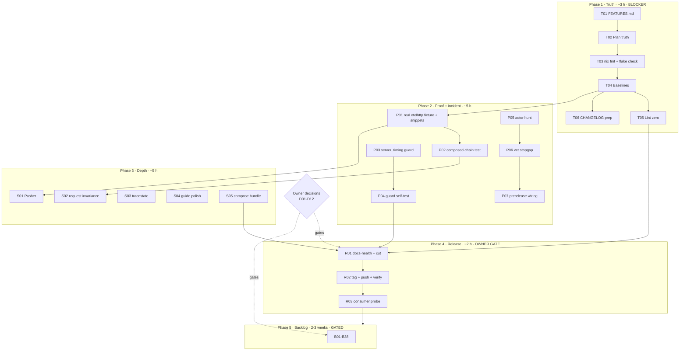

# Superb Completion, Hardening & Backlog Plan — Truth, Interop Proof, Release, 100%

- **Date:** 2026-10-23 17:32 CEST
- **Status:** NOT STARTED — plan only. Four owner decisions gate parts of phases 1, 3, and 4.
- **Supersedes (sequencing only):** the P4 backlog ordering in `docs/planning/2026-10-23_16-12_green-master-and-otel-tracing-1-4-20-plan.md`. Its rulings and non-goals stand.
- **Inputs:** `docs/status/2026-10-23_17-28_otel-tracing-p1-p3-execution-status.md` (50-item f-list), `docs/status/2026-10-23_15-56_otel-tracing-exploration-and-red-master.md`, ROADMAP Open questions + gated backlog, TODO_LIST, AGENTS.md.
- **Hard rule:** do not verschlimmbessern. Additive only, no new public API without an owner decision, no red tree, verify every step before the next.

---

## 0. TL;DR — what we should really do

1. **Make the completion claim true before adding anything.** The OTEL work is shipped, but the repo's own inventory (`FEATURES.md`) does not mention it, the source plan's tables still describe the pre-implementation shape, and the full flake gate was never run. Fix the truth surface first: it is cheap and it unblocks a safe release.
2. **Prove the interop claim against the real SDK.** `httpspec.RunTracing` is mutation-proven against fakes, not against `otelhttp`. The entire value of this work is "tracing composes with httputil"; proving it against a fake is not proof. Build a fixture module, compile both guide lanes, and keep the root dependency policy intact.
3. **Close the incident mechanism, not just the symptom.** The AST guard catches re-annotation in the root package only; `server_timing` is a separate module with no guard, and the actor that re-applied the sweep three times is still unidentified. Extend the guard, then hunt the actor.
4. **Release what is already built.** `[Unreleased]` now carries Language (v1.6.0) plus the OTEL hook and specs. A release is the only thing that delivers it to consumers through the module proxy and pkg.go.dev.
5. **Then work the backlog.** 36 gated items remain. Most are demand- or decision-gated; they are ROADMAP fuel, not commitments. Doing them before 1–4 repeats the original mistake of working on a red or unverified tree.

---

## 1. Ground truth (verified 2026-10-23 17:32)

| Fact | Evidence |
|---|---|
| Tree clean and synced before this plan | `## master...origin/master` after `2ca60fa`; the status report was swept into `b6e627c` (daemon) |
| Four deliberate commits pushed | `efae0e3` feature, `87faab3` lane+incident docs, `0ad2250` evidence/decision/harvest, `2ca60fa` routing |
| Go gates green | `go vet ./...` 0; `go test -race ./...` root/httpspec/scripts; `server_timing` green; `gofmt -l` empty |
| Lint not at zero | `golangci-lint run .` = 8 pre-existing: 7 unused `//nolint:gosec` (test files) + 1 gocyclo 24>20 (`FuzzCSRFMiddleware_XFPAttestation`) |
| `FEATURES.md` does not know the new work | `grep -c "RecoveryWithConfig\|TracingSpecs\|RunTracing" FEATURES.md` → `0` |
| `server_timing` has no sentinel guard | `ls server_timing/*sentinels*` → none |
| Source plan tables are stale | `P2.4` row still says `TracingSpecs` only and `Run(..., WithSpecs(...))`, an option that does not exist |
| Real-SDK proof absent | `httpspec.RunTracing` tested only with identity, header-stripping, and writer-hiding fakes |
| Full flake gate unrun | no `nix fmt` / `nix flake check` this session |

**Blast radius of skipping phase 1:** the next release ships a feature inventory that omits the feature, and the next session re-derives status from stale tables. This is the exact documentation-drift class the repo's docs-health cadence exists to prevent.

---

## 2. Pareto decomposition

### 2.1 The 1% that delivers 51% — make the claim verifiable

| Task | Effort | Why it dominates |
|---|---|---|
| T01 `FEATURES.md` inventory | 30 min | The repo's honest feature list is the single source other docs cite; it currently omits the whole OTEL deliverable |
| T02 Source-plan truth | 30 min | The plan that justified the work still describes the wrong API; future sessions will trust it |
| T03 `nix fmt` + `nix flake check` | 60 min | The only full gate never run; a green flake is the release precondition |
| T04 Baseline re-measure (erraudit, art-dupl, coverage) | 60 min | Restores the measured claims AGENTS/README make; detects drift from the new files |

**Bundle:** 3 hours. **Outcome:** every claim about the shipped work is true and measured, and the tree is releasable.

### 2.2 The 4% that delivers 64% — prove interop and close recurrence

| Task | Effort | Why it dominates |
|---|---|---|
| P01 Real-`otelhttp` fixture + compile both guide snippets | 100 min | Converts "works with fakes" into "works with the SDK consumers use"; also prevents doc rot |
| P02 `RunTracing` on a composed chain | 30 min | Proves the checks survive a realistic stack (tracing + RequestID + CORS + Recovery), not just identity |
| P03 Sentinel guard in `server_timing` | 60 min | The incident class has a second module with zero protection |
| P05 Hunt the sweep actor | 100 min | The guard is a backstop; without the actor, recurrence #4 is only blocked, not understood |

**Bundle:** 4.8 hours. **Outcome:** the interop claim is proven twice (unit + SDK) and the incident has both a backstop and a root cause.

### 2.3 The 20% that delivers 80% — deliver and harden

| Task | Effort | Why |
|---|---|---|
| R01 Docs-health + CHANGELOG cut v1.6.0 | 100 min | Release precondition |
| R02 Tag, push once, verify CI + pkg.go.dev | 100 min | Delivery |
| R03 Post-release consumer probe | 30 min | Confirms the module proxy actually serves the release |
| S01–S05 Tracing depth (Pusher, request invariance, tracestate, guide polish, compose bundle) | 300 min | Completes the contract surface and the guide |
| T05–T06 + P04 + P06–P07 | 240 min | Lint zero, changelog completeness, guard self-test, local stopgap, prerelease wiring |

**Bundle:** ~12.8 hours over 2 days. **Outcome:** consumers can use the release; the tracing story is complete enough to stop.

### 2.4 The other 20% to reach 100% — gated backlog

B01–B38 (all 38 remain gated; B01 and B02 are nearest because their decision notes already exist): demand- and decision-gated ROADMAP fuel, ~2–3 weeks. They execute only after their gate opens. They are not commitments and must not jump the queue.

---

## 3. Execution graph

```mermaid
gantt
    title Critical path (illustrative)
    dateFormat HH:mm
    axisFormat %H:%M
    section Phase 1 Truth
    T01 FEATURES           :t1, 17:45, 30m
    T02 plan truth         :t2, after t1, 30m
    T03 flake              :t3, after t2, 60m
    T04 baselines          :t4, after t3, 60m
    section Phase 2 Proof
    P01 fixture            :p1, after t4, 100m
    P02 composed test      :p2, after p1, 30m
    P03 st guard           :p3, after p2, 60m
    P05 actor hunt         :p5, after p3, 100m
    section Phase 3 Depth
    S01-S05                :s1, after p5, 300m
    section Phase 4 Release
    R01 docs-health        :r1, after s1, 100m
    R02 tag + push         :r2, after r1, 100m
```

---

## 4. Comprehensive plan — tasks of 30–100 minutes

Legend: **Imp** importance/impact 1–5 · **CV** customer value 1–5 · **Dep** dependencies · **Src** status-report item (`S1` = 2026-10-23_17-28, `S2` = 2026-10-23_15-56) or backlog ID.

### 4.1 Active plan (sorted by Imp, then CV, then effort)

| ID | Task | Imp | CV | Effort | Dep | Src | Verification / DoD |
|---|---|---|---|---|---|---|---|
| P01 | Real-`otelhttp` fixture module: run `RunTracing` against the real SDK, compile both `otel.md` lanes | 5 | 5 | 100 | T03 | S1-4, S1-5 | Fixture builds and all checks pass against `otelhttp.NewMiddleware`; both guide snippets compile; root `go.mod` unchanged |
| R01 | Docs-health VERIFY + CHANGELOG cut for v1.6.0 | 5 | 5 | 100 | T05, P04, S05 | S1-9 | Living docs verified; `[1.6.0]` section cut; compare link added; `[Unreleased]` retargeted |
| R02 | Release v1.6.0: prerelease gates, one tag push, CI + pkg.go.dev verification | 5 | 5 | 100 | R01 | S1-9 | `prerelease-check.sh` 0; tag pushed with master in ONE push; CI green; pkg.go.dev renders README + otel guide |
| T01 | `FEATURES.md` inventory refresh (hook, specs, guide, lane ruling) | 5 | 3 | 30 | — | S1-1 | Every new exported symbol and doc has a DONE row; counts re-derived |
| T03 | `nix fmt` + `nix flake check` (root; `--all-systems` optional) | 5 | 2 | 60 | T02 | S1-2 | Both exit 0; formatter changes committed; tests re-run if files changed |
| R03 | Post-release consumer probe in a scratch module | 4 | 4 | 30 | R02 | S1-9 | `go get github.com/larsartmann/httputil@v1.6.0` resolves; guide renders |
| T02 | Source-plan truth: P2.4 includes `RunTracing`, fix `WithSpecs`, mark P2.2/P2.6 executed | 4 | 2 | 30 | — | S1-3 | Plan tables match the tree; no nonexistent API named |
| T04 | Baseline re-measure: erraudit ledger, art-dupl, race coverage (root + httpspec) | 4 | 2 | 60 | T03 | S1-8, S1-9, S1-10 | Counts match AGENTS/README or the docs are updated |
| P03 | Sentinel guard in `server_timing` (separate module) | 4 | 2 | 60 | — | S1-14 | In-module test fails on a re-annotated sentinel; CI runs it |
| P05 | Hunt the sentinel-sweep actor | 4 | 1 | 100 | — | S1-13 | Actor identified or investigation closed with evidence |
| S04 | Guide polish: sampling, public-endpoint option names, cross-links | 3 | 3 | 60 | P01 | S1-21 | Every snippet verified against the module cache; no invented option |
| P02 | `RunTracing` on a composed chain (tracing + RequestID + CORS + Recovery) | 3 | 3 | 30 | P01 | S1-6 | Test passes; breaking one layer makes it fail |
| T06 | CHANGELOG "Documented" entry + release-link readiness check | 3 | 2 | 30 | — | S1-11, S1-12 | Entry present; no frozen section touched; link plan recorded |
| P06 | Local pre-sweep stopgap (`go build` + `go vet` script) | 3 | 2 | 60 | P05 | S1-16 | Script fails on a broken fixture and passes on HEAD; documented in AGENTS |
| T05 | Lint zero: remove confirmed-unused gosec directives, reduce fuzz gocyclo | 3 | 1 | 60 | T04 | S1-7 | `golangci-lint run` 0 issues; fuzz smoke green |
| P04 | Guard self-test (mutation fixture in CI, non-destructive) | 3 | 1 | 60 | P03 | S1-15 | Fixture with an annotation makes the guard fail; production behavior unchanged |
| S01 | `RunTracing` Pusher-preservation check | 2 | 2 | 60 | P01 | S1-18 | Fake pushable writer asserts `http.Pusher`; mutation-probed |
| S02 | `RunTracing` request-invariance check (method/path/body unchanged) | 2 | 2 | 60 | P02 | S1-19 | Probe compares request fields before/after; mutation-probed |
| S03 | `TracingSpecs` tracestate handling (passthrough + absent invariance) | 2 | 2 | 60 | P01 | S1-20 | New spec names + tests; handler-level semantics documented |
| S05 | `compose-bundles.md` tracing bundle example | 2 | 2 | 60 | S04 | S1-24 | Copy-paste bundle compiles conceptually; ordered per the matrix |
| P07 | Prerelease wiring: confirm `prerelease-check.sh` runs the sentinel guard | 2 | 1 | 30 | P03 | S1-17 | Script gate updated or confirmed; dry-run output shows the test |

### 4.2 Gated backlog (sorted by Imp, then CV)

| ID | Task | Imp | CV | Effort | Gate | DoD |
|---|---|---|---|---|---|---|
| B01 | Daemon pre-sweep build gate: owner ruling + wiring decision | 4 | 3 | 100 | owner | Ruling recorded; if approved, wiring plan + cost |
| B02 | RequestID correlation echo + fallback | 3 | 4 | 100 | D02 | Config field + tests + chain test + docs |
| B07 | Idempotency-key middleware design (native Store) | 3 | 4 | 100 | demand | Design note with API shape, replay semantics, test plan, owner question |
| B29 | brotli/zstd `WriterFactories` | 3 | 4 | 100 | demand | Factories + roundtrip/pooling tests + bench + doc |
| B30 | Prometheus `MetricsRecorder` | 3 | 4 | 100 | demand | Adapter + tests + doc + example |
| B36 | Runnable `example/` directory | 3 | 4 | 100 | demand | Builds in CI; README link; tracing-compatible wiring |
| B04 | HSTS middleware | 3 | 3 | 100 | demand | Validated config, header/preload tests, chain test, docs |
| B05 | HTTPS-redirect helper | 3 | 3 | 100 | demand | Trusted-proxy proto model, 301/308 policy, tests, docs |
| B08 | Shutdown-drain semantics | 3 | 3 | 100 | owner | Contract decided; drain test; regression test; docs |
| B10 | TLS-config clone-on-write | 3 | 3 | 60 | design | Internal clone; shared-config regression test |
| B11 | Consumer-audit program as standing tooling | 3 | 3 | 100 | owner | Job shape + first run + verdict schema |
| B17 | Quarterly consumer/importer scan | 3 | 3 | 30 | process | Scan run; baseline recorded; cadence documented |
| B27 | CSP `StrictCSP` preset | 3 | 3 | 100 | demand | Preset + nonce interplay tests + docs + changelog |
| B37 | HTTP/2 integration tests | 3 | 3 | 100 | — | h2 negotiation + middleware chain + ServerTiming under h2 |
| B03 | go.work membership policy | 3 | 1 | 30 | owner | Policy recorded; ROADMAP question closed |
| B12 | Consumer-audit operating model | 3 | 2 | 30 | owner | Three rulings recorded |
| B13 | Autonomous nightly-crasher authority | 3 | 1 | 30 | owner | Ruling + nightly docs updated |
| B14 | `AbsentEncodingFirstConfigured` lifecycle | 3 | 2 | 30 | owner | Lifecycle decided; v1-stability + non-goals updated |
| B15 | Branching-flow dispositions | 3 | 1 | 60 | owner | Three tool defects filed or suppressed; baseline policy recorded |
| B22 | go-etag `go` directive reconciliation | 3 | 2 | 30 | external repo | Tags vs directives reconciled; consumers unaffected |
| B06 | `MaxHeaderBytes` passthrough | 2 | 2 | 30 | demand | Field wired + zero-value test + doc |
| B09 | Nightly-fuzz workflow scaling | 2 | 1 | 60 | cost appetite | Matrix/concurrency/inputs decided; first nightly observed |
| B16 | `MiddlewareFunc.Append` decide-or-decline | 2 | 2 | 30 | owner | Decision recorded; no code if declined |
| B19 | Multi-module tag convention | 2 | 1 | 30 | owner | Convention recorded in RELEASE.md |
| B20 | Trash-process mystery | 2 | 1 | 60 | forensics | Reproduced or closed unsolvable with evidence |
| B21 | Commit-flow convention in daemon windows | 2 | 1 | 30 | owner | Ruling + AGENTS note |
| B25 | Tracked root binaries keep-or-untrack | 2 | 1 | 30 | owner | Decision applied + documented |
| B28 | CSRF Referer-attestation research | 2 | 2 | 100 | browser evidence | Evidence collected; scope decided or closed |
| B31 | `StartupHandler` decide-or-archive | 2 | 2 | 30 | owner | Decision recorded in ROADMAP |
| B32 | Property-test middleware stack ordering | 2 | 1 | 100 | — | Property tests green under `-race -count=10` |
| B33 | ServeTLS ALPN mutation probe | 2 | 2 | 30 | — | Probe fails when the mutation is removed |
| B34 | Fuzz-seed inventory policy | 2 | 1 | 30 | — | Policy + applied seed set |
| B38 | README flake-app discovery table | 2 | 3 | 30 | — | Table added; sales fit judged |
| B18 | Coverage-badge refresh step | 1 | 1 | 30 | — | Step in RELEASE.md; badge verifies |
| B23 | CHANGELOG granularity for docs | 1 | 1 | 30 | owner | Convention recorded |
| B24 | art-dupl `-t 1` baseline policy | 1 | 1 | 30 | owner | Policy recorded in AGENTS |
| B26 | Vestigial vendor references | 1 | 1 | 30 | — | References stripped or guarded + verified |
| B35 | `.d2` render CI check | 1 | 1 | 30 | — | Check added; diagrams render |

**Roll-up:** active = 1,240 min ≈ 21 h ≈ 3 working days. Backlog ≈ 2–3 weeks of gated work.

---

## 5. Twelve-minute decomposition

Every parent from section 4 is broken into steps of at most 12 minutes. A parent's steps execute in order; steps inherit the parent's gate.

### 5.1 Phase 1 — truth

| ID | Parent | Step (≤12 min) | Verify |
|---|---|---|---|
| T01.1 | T01 | Read `FEATURES.md` structure; list the DONE sections that must gain a row | Insertion points named |
| T01.2 | T01 | Add `RecoveryConfig`/`RecoveryWithConfig` + `OnPanic` DONE row | Row cites `recovery.go` and tests |
| T01.3 | T01 | Add `TracingSpecs` + `RunTracing` DONE rows with spec counts | Counts match `go doc` |
| T01.4 | T01 | Add the OTEL guide + lane ruling to the docs inventory | Link resolves |
| T01.5 | T01 | Re-derive example/spec counts; update any stale figures | No stale count remains |
| T02.1 | T02 | Correct the P2.4 row: `TracingSpecs` + `RunTracing`, `WithExtraSpecs` not `WithSpecs` | Grep finds no `WithSpecs` |
| T02.2 | T02 | Mark P2.2, P2.4, P2.6 executed in §4.1 and §9 | Status matches commits |
| T02.3 | T02 | Update the graph label and §5.1 subtasks for P2.4 | Diagram text matches |
| T02.4 | T02 | Cross-link the status report and this plan | Both links resolve |
| T03.1 | T03 | `git status --short` snapshot before formatter | Snapshot saved |
| T03.2 | T03 | `nix fmt` | Exit 0; inspect diff |
| T03.3 | T03 | `nix flake check` | Exit 0 |
| T03.4 | T03 | Re-run `go test -race ./...` if formatting changed Go files | Green |
| T03.5 | T03 | Record the flake result in the plan progress log | Entry present |
| T04.1 | T04 | `erraudit --type-aware`; record exact counts | Ledger matches or docs updated |
| T04.2 | T04 | Both real erraudit gates | Exit 0 |
| T04.3 | T04 | `art-dupl -t 2` and `-t 1` | 0 groups / accepted pairs only |
| T04.4 | T04 | Race coverage root + httpspec | Percentages recorded |
| T04.5 | T04 | Update AGENTS/README only if numbers drifted | No stale claim |
| T05.1 | T05 | Cold-cache gosec probe for the seven directive sites | gosec verdict per site |
| T05.2 | T05 | Remove the seven directives that gosec no longer needs | `nolintlint` clean |
| T05.3 | T05 | Reduce `FuzzCSRFMiddleware_XFPAttestation` complexity below 20 | gocyclo silent |
| T05.4 | T05 | `golangci-lint run` root + httpspec | 0 issues |
| T05.5 | T05 | Smoke-run the refactored fuzz target | 30 s clean |
| T06.1 | T06 | Add the "Documented" entry for lane ruling + correlation note | Entry present |
| T06.2 | T06 | Verify `[Unreleased]` subsections and the future compare link | Link plan recorded |
| T06.3 | T06 | Confirm no frozen version section was touched | `git diff` scope |

### 5.2 Phase 2 — proof and incident

| ID | Parent | Step (≤12 min) | Verify |
|---|---|---|---|
| P01.1 | P01 | Create a scratch module with `otelhttp` + `appkitotel` (outside root `go.mod`) | `go mod tidy` clean |
| P01.2 | P01 | Add `replace github.com/larsartmann/httputil => ../..` | `go list` resolves local |
| P01.3 | P01 | Run `httpspec.RunTracing(t, otelhttp.NewMiddleware(...))` | All four checks pass |
| P01.4 | P01 | If a check fails, decide spec-vs-SDK defect; fix the smaller one | Documented decision |
| P01.5 | P01 | Extract and compile the bare-`otelhttp` guide snippet | Builds |
| P01.6 | P01 | Extract and compile the `appkitotel` guide snippet | Builds |
| P01.7 | P01 | Decide fixture placement (scripts module vs docs-only) | Decision recorded |
| P01.8 | P01 | Verify root `go.mod`/`go.sum` unchanged | `git diff` empty |
| P02.1 | P02 | Compose fake tracing + RequestID + CORS + Recovery + probe | Compiles |
| P02.2 | P02 | Run `RunTracing` on the chain | Passes |
| P02.3 | P02 | Add the test to `httpspec` | Green under `-race` |
| P02.4 | P02 | Break one layer; confirm the check fails | Mutation proven |
| P03.1 | P03 | Inventory `server_timing` package-level sentinels | List complete |
| P03.2 | P03 | Add the adapted AST guard test in that module | Test compiles |
| P03.3 | P03 | Run in-module tests under `-race` | Green |
| P03.4 | P03 | Confirm CI runs in-module tests (it does; verify path) | CI config cited |
| P03.5 | P03 | Mutation: annotate one sentinel; expect failure | Fails, then reverts |
| P04.1 | P04 | Refactor the guard to accept a directory (production call unchanged) | Root test still passes |
| P04.2 | P04 | Create a `t.TempDir` fixture with one annotated sentinel | Fixture written |
| P04.3 | P04 | Assert the guard reports it | Test passes |
| P04.4 | P04 | Add the same self-test to `server_timing` | Passes there |
| P05.1 | P05 | Collect erraudit invocation history and tool versions | Evidence list |
| P05.2 | P05 | Search shell/agent history for the rewrite command | Hits or none |
| P05.3 | P05 | Inspect tool configs for the rule that suggests the migration | Config cited |
| P05.4 | P05 | Reproduce on a scratch copy if possible | Reproduced or not |
| P05.5 | P05 | Record the verdict in the incident docs | Entry present |
| P06.1 | P06 | Write `scripts/pre-sweep-check.sh` (`go build` + `go vet`) | Script executable |
| P06.2 | P06 | Test on HEAD and on a deliberately broken fixture | Pass then fail |
| P06.3 | P06 | Document invocation in AGENTS Commands | Entry present |
| P06.4 | P06 | Decide whether to wire it into anything (no daemon change) | Decision recorded |
| P07.1 | P07 | Read `scripts/prerelease-check.sh` gate list | Gate map |
| P07.2 | P07 | Confirm the guard tests are included in its `go test` | Citation |
| P07.3 | P07 | Add an explicit `-run` if the suite can skip it | Diff |
| P07.4 | P07 | Dry-run the script's changed gate | Output shows the test |

### 5.3 Phase 3 — tracing depth

| ID | Parent | Step (≤12 min) | Verify |
|---|---|---|---|
| S01.1 | S01 | Add a fake writer implementing `http.Pusher` | Compiles |
| S01.2 | S01 | Record `canPush` in the probe | Field added |
| S01.3 | S01 | Add the check + failure message | Check runs |
| S01.4 | S01 | Mutation: hide `Pusher`; expect failure | Fails |
| S01.5 | S01 | Update `RunTracing` godoc + guide | Docs list it |
| S02.1 | S02 | Record method/path/body digest in the probe | Fields added |
| S02.2 | S02 | Add the invariance check | Runs |
| S02.3 | S02 | Mutation: mutate one field; expect failure | Fails |
| S02.4 | S02 | Update godoc + guide | Docs list it |
| S03.1 | S03 | Define spec names for tracestate passthrough/absence | Constants added |
| S03.2 | S03 | Implement the two checks | Checks pass on plain handler |
| S03.3 | S03 | Mutation-probe both | Both fail correctly |
| S03.4 | S03 | Register in `TracingSpecs` + docs | Counts updated |
| S04.1 | S04 | Add a sampling section (what httputil does/does not do) | Section reads correctly |
| S04.2 | S04 | Verify `WithPublicEndpoint` vs `WithPublicEndpointFn` wording | Source-checked |
| S04.3 | S04 | Add cross-links (arch-ref, ROADMAP, compose bundle) | Links resolve |
| S04.4 | S04 | Proofread + markdown sanity | No broken fence |
| S05.1 | S05 | Read `compose-bundles.md` structure | Outline |
| S05.2 | S05 | Add an ordered tracing bundle snippet | Snippet correct |
| S05.3 | S05 | State the Recovery-inside-span rule in the bundle text | Rule present |
| S05.4 | S05 | Cross-link `otel.md` | Link resolves |

### 5.4 Phase 4 — release

| ID | Parent | Step (≤12 min) | Verify |
|---|---|---|---|
| R01.1 | R01 | Run docs-health VERIFY on README/AGENTS/ROADMAP/TODO_LIST/FEATURES | Findings list |
| R01.2 | R01 | Fix stale claims; delete struck TODO rows | Docs consistent |
| R01.3 | R01 | Confirm the version: minor (additive hook + specs) = v1.6.0 | Rationale recorded |
| R01.4 | R01 | Cut `[1.6.0]` from `[Unreleased]` (freeze) | Section moves |
| R01.5 | R01 | Add the `[1.6.0]:` compare link; retarget `[Unreleased]` | Link check passes |
| R01.6 | R01 | Verify `server_timing` needs no tag (unchanged) | Diff evidence |
| R01.7 | R01 | Re-read the release checklist gates 1–9 | Checklist signed off |
| R02.1 | R02 | `scripts/prerelease-check.sh` | Exit 0 |
| R02.2 | R02 | `go test -race -count=10 ./...` | Exit 0 |
| R02.3 | R02 | `nix flake check` final | Exit 0 |
| R02.4 | R02 | Create annotated tag `v1.6.0` | Tag exists |
| R02.5 | R02 | Push master + tag in ONE `git push` | Both refs on origin |
| R02.6 | R02 | Watch CI to green on the exact head | Green |
| R02.7 | R02 | Verify pkg.go.dev renders README + guide | Rendered |
| R02.8 | R02 | Publish GitHub release notes | Release object exists |
| R03.1 | R03 | Scratch module `go get ...@v1.6.0` | Resolves |
| R03.2 | R03 | Build a handler using `RecoveryWithConfig` + `RunTracing` | Builds |
| R03.3 | R03 | Record the probe in the status report | Entry present |

### 5.5 Backlog (gated) — 30–60 min parents

| ID | Parent | Step (≤12 min) | Verify |
|---|---|---|---|
| B01.1 | B01 | Re-read gate proposal + incident evidence | Facts confirmed |
| B01.2 | B01 | List wiring options and costs | Options table |
| B01.3 | B01 | Draft ruling + owner question | Recorded |
| B01.4 | B01 | If approved, write the wiring plan | Plan exists |
| B02.1 | B02 | Re-read the correlation ruling | Option confirmed |
| B02.2 | B02 | Design header precedence/fallback matrix | Matrix written |
| B02.3 | B02 | Extend `RequestIDConfig` + validation | Compiles |
| B02.4 | B02 | Implement echo + fallback | Works |
| B02.5 | B02 | Tests: present/absent/both/empty | Green |
| B02.6 | B02 | Chain test (RequestID inside CORS/CSRF) | Green |
| B02.7 | B02 | Godoc + migration note | Docs |
| B02.8 | B02 | Verify: gofmt, vet, race, lint | 0 |
| B03.1 | B03 | Collect go.work evidence | Evidence |
| B03.2 | B03 | Draft membership policy | Draft |
| B03.3 | B03 | Apply to ROADMAP + AGENTS | Recorded |
| B04.1 | B04 | Design `HSTSConfig` + validation | Design |
| B04.2 | B04 | Error codes + templates + lists | Compiles |
| B04.3 | B04 | Middleware core | Works |
| B04.4 | B04 | Preload eligibility guard | Works |
| B04.5 | B04 | Header + rejection tests | Green |
| B04.6 | B04 | Example + godoc | Output pinned |
| B04.7 | B04 | Chain test | Green |
| B04.8 | B04 | Verify all gates | 0 |
| B05.1 | B05 | Design redirect rules | Design |
| B05.2 | B05 | Reuse `TrustedProxySet` | Wired |
| B05.3 | B05 | Middleware core (301/308) | Works |
| B05.4 | B05 | Preserve query + optional host | Works |
| B05.5 | B05 | Tests: trusted/untrusted/TLS/HSTS | Green |
| B05.6 | B05 | Example + godoc | Output pinned |
| B05.7 | B05 | Chain test | Green |
| B05.8 | B05 | Verify all gates | 0 |
| B06.1 | B06 | Add `MaxHeaderBytes` + wire | Compiles |
| B06.2 | B06 | Translation + zero-value test | Green |
| B06.3 | B06 | Godoc + AGENTS note | Docs |
| B07.1 | B07 | Collect Stripe semantics + fleet evidence | Evidence |
| B07.2 | B07 | Design `Store` interface | Design |
| B07.3 | B07 | Design replay semantics | Design |
| B07.4 | B07 | Compare recorder reuse vs dedicated cache | Decision |
| B07.5 | B07 | Draft design note | Note exists |
| B07.6 | B07 | Test plan | Plan |
| B07.7 | B07 | Owner question | Recorded |
| B07.8 | B07 | Link/archive | Resolved |
| B08.1 | B08 | Reproduce drain race | Failing test |
| B08.2 | B08 | Contract options | Options |
| B08.3 | B08 | Decide + record | Recorded |
| B08.4 | B08 | Implement wait tracking | Works |
| B08.5 | B08 | Regression test | Green |
| B08.6 | B08 | Shutdown/ListenerAddr tests | Green |
| B08.7 | B08 | Godoc update | Docs |
| B08.8 | B08 | Verify all gates | 0 |
| B09.1 | B09 | Draft matrix/concurrency | Draft |
| B09.2 | B09 | Add concurrency group | YAML valid |
| B09.3 | B09 | Add dispatch inputs | YAML valid |
| B09.4 | B09 | Dry-run with a workflow linter | Clean |
| B09.5 | B09 | Observe first nightly | Recorded |
| B10.1 | B10 | Design clone-on-write | Design |
| B10.2 | B10 | Implement clone | Works |
| B10.3 | B10 | Remove test workaround | Green |
| B10.4 | B10 | Shared-config regression test | Green |
| B10.5 | B10 | Verify all gates | 0 |
| B11.1 | B11 | Define job + verdict schema | Schema |
| B11.2 | B11 | Script skeleton | Runs |
| B11.3 | B11 | First check (version drift) | Runs |
| B11.4 | B11 | First run + baseline | Recorded |
| B11.5 | B11 | Persist verdicts | Files |
| B11.6 | B11 | Document procedure | Doc |
| B11.7 | B11 | Schedule decision | Recorded |
| B11.8 | B11 | Script lint + dry run | 0 |
| B12.1 | B12 | Collect manifest evidence | Evidence |
| B12.2 | B12 | Draft three rulings | Draft |
| B12.3 | B12 | Route to owner | Recorded |
| B13.1 | B13 | Inventory precedent | Evidence |
| B13.2 | B13 | Draft authority options | Options |
| B13.3 | B13 | Record + update nightly docs | Recorded |
| B14.1 | B14 | Collect consumer usage | Evidence |
| B14.2 | B14 | Draft lifecycle options | Options |
| B14.3 | B14 | Record + update v1-stability/ROADMAP | Recorded |
| B15.1 | B15 | Re-verify three tool defects | Verified |
| B15.2 | B15 | Decide file vs suppress | Decision |
| B15.3 | B15 | File or ignore | Done |
| B15.4 | B15 | Record baseline policy | Recorded |
| B15.5 | B15 | Verify tool run | Runs |
| B16.1 | B16 | Check gorilla parity + demand | Evidence |
| B16.2 | B16 | Draft API shape if pursued | Draft |
| B16.3 | B16 | Decide/decline + record | Recorded |
| B17.1 | B17 | Draft scan job shape | Design |
| B17.2 | B17 | First scan | Output |
| B17.3 | B17 | Baseline + cadence | Recorded |
| B18.1 | B18 | Locate badge source + refresh command | Command |
| B18.2 | B18 | Add step to RELEASE.md | Doc |
| B18.3 | B18 | Verify render | Rendered |
| B19.1 | B19 | Inventory tag conventions | Inventory |
| B19.2 | B19 | Draft convention | Draft |
| B19.3 | B19 | Record in RELEASE.md | Doc |
| B20.1 | B20 | Re-read inotify evidence | Evidence |
| B20.2 | B20 | Reproduce with inotifywait | Reproduced or not |
| B20.3 | B20 | Snapshot process list on event | Snapshot |
| B20.4 | B20 | Identify actor or close | Verdict |
| B20.5 | B20 | Record outcome | Recorded |
| B21.1 | B21 | Collect recent daemon races | Evidence |
| B21.2 | B21 | Draft options | Options |
| B21.3 | B21 | Record + AGENTS note | Recorded |
| B22.1 | B22 | Compare tags vs directives | Diff |
| B22.2 | B22 | Reconcile in that repo | Done |
| B22.3 | B22 | Verify consumers | Green |
| B23.1 | B23 | Collect doc-only examples | Examples |
| B23.2 | B23 | Decide granularity | Decision |
| B23.3 | B23 | Record in AGENTS/CHANGELOG policy | Recorded |
| B24.1 | B24 | Re-measure `-t 1` | Baseline |
| B24.2 | B24 | Decide gate policy | Decision |
| B24.3 | B24 | Record in AGENTS | Recorded |
| B25.1 | B25 | Inventory binaries + size | Inventory |
| B25.2 | B25 | Decide keep/untrack | Decision |
| B25.3 | B25 | Apply + document | Done |
| B26.1 | B26 | Grep vendor references | List |
| B26.2 | B26 | Decide strip/guard | Decision |
| B26.3 | B26 | Apply + verify linters | 0 |
| B27.1 | B27 | Read Mozilla StrictCSP + map | Mapping |
| B27.2 | B27 | Design preset + hooks | Design |
| B27.3 | B27 | Implement preset | Works |
| B27.4 | B27 | Header + nonce tests | Green |
| B27.5 | B27 | Docs + example | Docs |
| B27.6 | B27 | SecurityHeaders interplay | Green |
| B27.7 | B27 | Verify all gates | 0 |
| B27.8 | B27 | CHANGELOG | Entry |
| B28.1 | B28 | Collect browser Referer evidence | Evidence |
| B28.2 | B28 | Review nosurf referer path | Notes |
| B28.3 | B28 | Define contradiction scope | Scope |
| B28.4 | B28 | Design test matrix | Matrix |
| B28.5 | B28 | Spike implementation | Spike |
| B28.6 | B28 | Owner question | Recorded |
| B28.7 | B28 | Decide or defer | Recorded |
| B28.8 | B28 | Verify note links | 0 |
| B29.1 | B29 | Read brotli/zstd doc pattern | Pattern |
| B29.2 | B29 | Brotli factory | Works |
| B29.3 | B29 | Zstd factory | Works |
| B29.4 | B29 | Roundtrip + pooling tests | Green |
| B29.5 | B29 | Benchmarks | Numbers |
| B29.6 | B29 | Doc update | Doc |
| B29.7 | B29 | Verify vet/race/bench | 0 |
| B29.8 | B29 | Changelog + snippet | Done |
| B30.1 | B30 | Review recorder interface | Notes |
| B30.2 | B30 | Prometheus adapter | Works |
| B30.3 | B30 | Tests with testutil | Green |
| B30.4 | B30 | Doc + example | Docs |
| B30.5 | B30 | Verify gates | 0 |
| B30.6 | B30 | Changelog | Entry |
| B30.7 | B30 | Consumer snippet | Snippet |
| B30.8 | B30 | Archive if no demand | Decision |
| B31.1 | B31 | Re-read design | Notes |
| B31.2 | B31 | Decide implement/archive | Decision |
| B31.3 | B31 | Record in ROADMAP | Recorded |
| B32.1 | B32 | List ordering invariants | List |
| B32.2 | B32 | Random stack generator | Compiles |
| B32.3 | B32 | Validate agrees with execution | Property |
| B32.4 | B32 | Names unique | Property |
| B32.5 | B32 | Build idempotent | Property |
| B32.6 | B32 | Shrink failures | Works |
| B32.7 | B32 | `-race -count=10` | Green |
| B32.8 | B32 | Docs | Docs |
| B33.1 | B33 | Reproduce ALPN mutation | Observed |
| B33.2 | B33 | Probe test | Green |
| B33.3 | B33 | Mutation-verify | Fails on removal |
| B34.1 | B34 | Inventory seeds | List |
| B34.2 | B34 | Draft policy | Draft |
| B34.3 | B34 | Apply | Applied |
| B35.1 | B35 | Find all `.d2` | List |
| B35.2 | B35 | Add render check | CI step |
| B35.3 | B35 | Verify render | Renders |
| B36.1 | B36 | Scaffold `example/` | Builds |
| B36.2 | B36 | Middleware chain main | Runs |
| B36.3 | B36 | Lifecycle demo | Runs |
| B36.4 | B36 | Tracing-compatible wiring | Runs |
| B36.5 | B36 | CI build | Green |
| B36.6 | B36 | README link | Resolves |
| B36.7 | B36 | Verify run/build | 0 |
| B36.8 | B36 | Changelog | Entry |
| B37.1 | B37 | TLS h2 harness | Compiles |
| B37.2 | B37 | h2 negotiation test | Green |
| B37.3 | B37 | Chain under h2 | Green |
| B37.4 | B37 | ServerTiming under h2 | Green |
| B37.5 | B37 | Race run | Green |
| B37.6 | B37 | Docs note | Doc |
| B37.7 | B37 | Verify vet/race | 0 |
| B37.8 | B37 | Changelog | Entry |
| B38.1 | B38 | Draft flake-app table | Table |
| B38.2 | B38 | Place in README + judge fit | Added |
| B38.3 | B38 | Verify commands | Run |

---

## 6. Decision queue (owner gates, not action items)

| ID | Decision | Blocks | Recommended |
|---|---|---|---|
| D01 | Daemon pre-sweep build gate (pma) | B01 | Option (b): default-on for Go repos, per-repo opt-out |
| D02 | RequestID correlation convention | B02 | Option A: `X-Correlation-ID` echo + fallback, default off; traceparent never seeds RequestID |
| D03 | OTEL lane sign-off, including `RunTracing` as new public API | R01 release framing | Keep both; they are additive and documented |
| D04 | go.work membership policy | B03 | Membership requires go.work + CI coverage, or explicit exemption |
| D05 | `AbsentEncodingFirstConfigured` lifecycle | B14 | Decide permanent vs pre-declared v2 removal |
| D06 | `MiddlewareFunc.Append` | B16 | Decide or decline with parity evidence |
| D07 | Shutdown-drain contract | B08 | Decide block-until-serve-exits vs document the race |
| D08 | TLS clone-on-write | B10 | Clone internally; document the current mutation hazard |
| D09 | Tracked root binaries | B25 | Decide keep vs untrack + build on demand |
| D10 | art-dupl `-t 1` gate policy | B24 | Document as a sweep gate with the accepted pairs |
| D11 | CHANGELOG granularity for docs | B23 | Code/API only in versioned sections; docs in `[Unreleased]`? |
| D12 | Website "no flake.nix" guard | cross-repo | Retire after the fleet flake migration |

---

## 7. Anti-verschlimmbesserung rules

1. **No new public API** until a decision row names it. `RunTracing` already slipped in; do not repeat that. `Pusher`/invariance/tracestate checks extend existing functions, they do not add symbols.
2. **No dependency in the root module.** The `otelhttp`/`appkitotel` proof lives in a fixture module outside the root `go.mod`.
3. **No re-litigating settled rulings:** two OTEL lanes, no `httputil/otel` sub-module, no third correlation mechanism, no re-tagging.
4. **Truth before features.** Phase 1 completes before Phase 2 starts.
5. **One semantic commit per unit.** The daemon is active; use the single-invocation consolidation pattern and `--no-verify` only because `dprint` is absent.
6. **Snapshot before any formatter or `--fix`.** Parallel sessions and the daemon share this tree.
7. **Measure, do not infer.** Baselines are re-derived with commands, never arithmetic.
8. **Do not fix unrelated pre-existing findings silently.** T05 is the explicit, scoped exception.
9. **Verify the delivering layer.** For docs, the file on disk; for releases, pkg.go.dev and `go get`; for guards, a mutation probe.

---

## 8. Explicit non-goals

- Rebuilding `otelhttp` or `go-appkit/otel` functionality in httputil.
- An `httputil/otel` sub-module.
- A third correlation header or baggage key.
- Removing or loosening existing specs to make the tracing checks pass.
- Bulk-executing the gated backlog before phase 1–4.
- Force-pushing, re-tagging, or rewriting published history.

---

## 9. Definition of done

| Phase | DoD |
|---|---|
| 1 Truth | `FEATURES.md` names every new symbol; plan tables match the tree; `nix flake check` 0; baselines re-measured; `golangci-lint run` 0 |
| 2 Proof | `RunTracing` passes against real `otelhttp`; both guide snippets compile; `server_timing` guard mutation-proven; actor verdict recorded; stopgap script works |
| 3 Depth | Pusher + invariance + tracestate checks mutation-proven; guide has sampling/public-endpoint sections; tracing bundle documented |
| 4 Release | `[1.6.0]` frozen with compare link; prerelease gates 0; ONE push with tag; CI green; pkg.go.dev renders; consumer probe passes |
| 5 Backlog | Each item implemented, archived with a decision, or re-parked with a demand gate |

---

## 10. Commit protocol

1. `docs:` truth bundle (FEATURES + plan + CHANGELOG prep) after T01–T02 and T06.
2. `chore:` or `fix:` lint/baseline changes after T04–T05, one commit.
3. `test:` interop proof + guard extension after P01–P04.
4. `docs:` actor verdict + stopgap after P05–P07.
5. `feat:` tracing depth checks after S01–S03; `docs:` for S04–S05.
6. `release: v1.6.0` as the cut commit; tag and push in ONE push.
7. Backlog: one commit per item, gated.

---

## 11. Progress log

- 2026-10-23 17:32 — plan created; no tasks executed. Four owner decisions gate phase 4 and the backlog.
- 2026-10-23 18:05 — **Phase 1 (truth) executed.**
  - T01: `FEATURES.md` now names `RecoveryConfig`/`RecoveryWithConfig`/`OnPanic`, `TracingSpecs`, `RunTracing`, the OTEL guide, the lane ruling, and the sentinel guard. Counts re-derived from the tree: 60 examples (45 root / 10 httpspec / 5 server_timing), 53 benchmarks, 30 fuzz targets, 32 httpspec specs from 13 extras. A missing row was found: `ExampleRecoveryWithConfig` had never entered the inventory.
  - T02: the source plan's P2.4 row and mermaid label now name `TracingSpecs` plus `RunTracing` and `WithExtraSpecs`; section 9 marks P2.2/P2.4/P2.6 executed and adds `RunTracing` to the owner sign-off list.
  - T03: `nix fmt` reported 0 changed files; `nix flake check` printed "all checks passed"; `go vet` and `go test -race` green in both modules.
  - T04: baselines re-measured with commands. Coverage is 98.7% root (was 97.9%), 98.6% httpspec, 100% server_timing. erraudit `119791b` reports 51 sentinel findings (36 now tool-labeled load-bearing) plus 1 `legacy_is`; both real gates exit 0; the AGENTS ledger now records that the drop from 49 advisories was a tool change, not a code change. art-dupl unchanged (exactly the two accepted pairs at `-t 1`). README drift found and fixed: "26 of 30 fuzz targets" (all 30 are wired) and a stale coverage row.
  - T05: lint zero. Removed the seven unused `//nolint:gosec` directives (gosec is silent at all seven sites) and dropped `FuzzCSRFMiddleware_XFPAttestation` below the complexity limit by extracting three helpers. The mandatory 30-second smoke run then found a real oracle defect: mixed-case `httpS` is honored by the parser but was rejected by the oracle. Oracle fixed to mirror the documented normalization, minimized seed committed, fuzz re-run 30 seconds clean, lint 0 issues.
  - T06: CHANGELOG `[Unreleased]` gained Documented entries (lane ruling and correlation ruling, baseline re-measurement) and a Fixed entry for the oracle defect; no frozen version section touched; the `[Unreleased]` compare link still targets `v1.5.0...HEAD` for the v1.6.0 cut.
  - Coverage hardening inside T04: every `tracing_specs.go` check is 100% covered and each failure arm mutation-probed; the two remaining gaps (`RunTracing` failure-forwarding lines, the deliberate `Hijack` stub) carry documented reasons.

- 2026-10-23 18:55 — **Phase 2 (proof + incident) executed.**
  - P01: `testdata/otelinterop/` is a separate module (`go 1.27.3`, required by appkit/otel v0.3.0) with `replace github.com/larsartmann/httputil => ../..`. It compiles both guide lanes plus the `OnPanic` bridge and runs `RunTracing` against real `otelhttp.NewMiddleware`, `otelhttp.WithPublicEndpointFn`, `appkitotel.Middleware()`, and the prescribed full chain. **Building it found a real defect**: both guide snippets called `Chain(mw1, mw2)(handler)`, but `Chain(handler, mw...)` takes the handler first, so neither compiled. Guide fixed to `Compose`, with the two valid spellings documented. Root `go.mod`/`go.sum` unchanged (verified). Placement decision (P01.7): `testdata/` + a dedicated CI job `otel-interop`, so the fixture cannot rot and `./...` never traverses it.
  - P02: `httpspec` gained a composed-chain pass test (header stamping + panic-to-500 + interface-preserving writer wrapper) and a composed-chain mutation probe that swaps in an interface-hiding wrapper. Renamed the test double to `passthroughWriter` after `art-dupl -t 1` flagged a 3-line clone against `server_timing`; baseline restored to exactly the two accepted pairs.
  - P03: `server_timing/sentinels_type_test.go` mirrors the guard. That module has no error-family dependency, so the assertion currently holds trivially — which is the point of a backstop — and a mutation probe (temporary `var errMutationProbe error`) confirmed the guard fails on an annotated sentinel, then was removed.
  - P04: the root guard's detector now takes a `sentinelReporter` interface (the part of `testing.T` it uses) and a `t.TempDir()` fixture test proves one annotated sentinel produces exactly one finding naming it. Same self-test in `server_timing`.
  - P05: **actor identified.** `erraudit lint --help` has no `--fix`, so no mechanical tool applied the rewrite; it is an agent applying `BuildFlow/docs/GOTCHAS.md` #125 ("sentinels MUST be declared as the error interface type") to a repo where sentinels are load-bearing. The tool's own load-bearing analysis is incomplete: `ErrCSRFInvalid` still gets the rewrite hint although its only method call site is `example_test.go:859`, because the analysis reads non-test files. Verdict recorded in the AGENTS erraudit block and in the daemon gate proposal; upstream fixes are owner-gated cross-repo items.
  - P06: `scripts/pre-sweep-check.sh` (build + vet + both guards in ~30s). Verified: exit 0 on HEAD, exit 1 with a clear "BROKEN TREE" message when a temporary undefined symbol is added (probe removed after).
  - P07: `scripts/prerelease-check.sh` step 4a now names both guard tests explicitly, so a rename cannot silently drop the gate; both commands dry-ran green. Removed the stale `GOEXPERIMENT=jsonv2` export (json/v2 is standard in Go 1.27 and the flag is a no-op; AGENTS already recorded the drop).
  - Gates after Phase 2: `golangci-lint run` 0 issues (root + httpspec), `go test -race` green in both modules, fixture `go build`/`go test -race` green, `art-dupl -t 2` 0 shown / `-t 1` the two accepted pairs.
