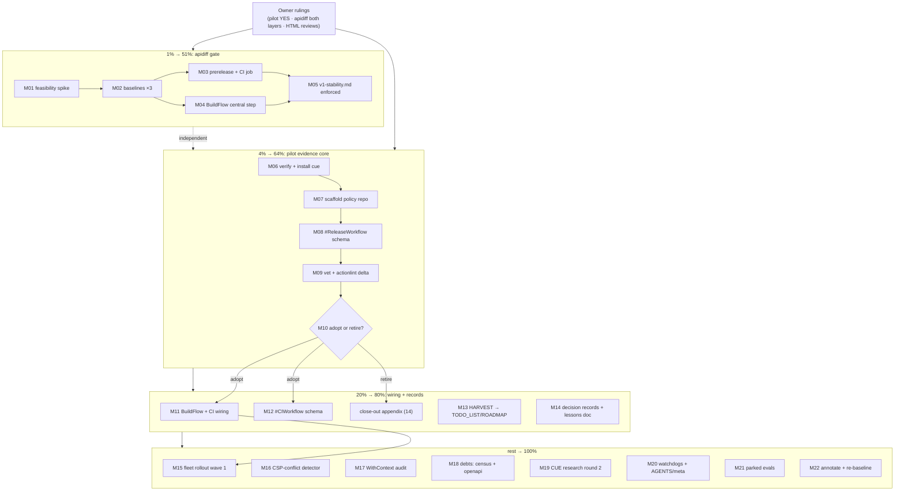

# Pareto Master Plan — CUE Pilot + apidiff Gate (post-ruling execution)

- **Created:** 2026-11-02 05:05 CET (date via CLI)
- **Input:** [status report 2026-11-02_04-56](../status/2026-11-02_04-56_cue-research-and-adoption-decision.md) — its section (f) is the complete work pool (40 items), now including the owner rulings recorded in that report's appendix.
- **Owner rulings applied:** Q1 = run the CUE pilot · Q2 = apidiff gate in BOTH layers (per-repo CI + central BuildFlow step) · Q3 = brutal self-reviews as separate HTML series.
- **Skill:** pareto-planning (Step 0–4). User overrides applied: fine-granularity cap 12 min (not 15); output is `.md` with mermaid graph (not HTML); commit AND push explicitly requested.

---

## 1. Context (why this plan exists)

**Session verdict (verified against primary sources, cuelang.org, 2026-11-02):** CUE is worth adopting in exactly one lane — an external `cue vet` validation tool for multi-source untyped data files (GitHub workflows) — and is explicitly rejected as a Go dependency (depguard allowlist + fleet policy: govalid/Huma/go-faster-yaml own the in-Go validation lanes) and for tool-owned config formats.

**The second, independent track:** `docs/v1-stability.md` promises a frozen API surface after v1.0, but nothing mechanical enforces it (verified: zero `apidiff` usage in the repo). CUE's own "spec-containment" idea — machine-checking "is any instance of schema A also an instance of B (backwards compatible?)" — has a direct Go equivalent. Owner ruling Q2 puts the gate in both layers.

**Timing:** `[Unreleased]` carries a pending minor tag (v1.6.0: Language + OTEL). Landing the apidiff gate BEFORE that tag means the first baseline can be generated at a clean released tag and every future tag is protected.

**Current repo position (Step 0 verified):** master == origin, tree has only a pre-existing `flake.lock` bump + this session's untracked status report. TODO_LIST/ROADMAP contain NONE of the 40 items (grep-verified: no apidiff/cue in CHANGELOG; no CSP-conflict detector in code) — so HARVEST is purely additive, no stale-dispatch risk.

## 2. Pareto Breakdown (ALL 40 items mapped)

Ruling-derived done items: **#1** (pilot decision = YES) and **#38** (self-review format = HTML series) are closed by the owner's answers — recorded, no work left.

### 1% → 51% of the result: **the apidiff gate, end-to-end, both layers** (items 15, 16, 31, 17, 18, 19, 20)

The only slice with guaranteed, permanent, compounding value: it converts the repo's most important written promise (frozen v1 API) into a mechanical gate that fails CI on the first incompatible change — and scales fleet-wide through BuildFlow per ruling Q2. Zero adoption risk, no behavioral change, protects every future tag.

### 4% → 64%: **+ the CUE pilot evidence core** (items 2, 3, 4, 5, 7, 8, 9, 14)

The owner green-lit the pilot; this slice produces the adopt/retire evidence in the cheapest possible way: verify packaging → install pinned → scaffold policy module → schema for release.yml → vet + actionlint delta matrix → adoption memo. Everything downstream of the delta matrix is explicitly conditional on it.

### 20% → 80%: **+ pilot wiring (if adopted), records, HARVEST** (items 10, 11, 6, 21, 22, 23, 24)

Wiring the vet into BuildFlow/CI, the ci.yml schema, the two decision records, the durable lessons doc, and pulling this whole plan into the living backlog (TODO_LIST/ROADMAP) so it survives the session.

### The other 20% → 100%: **rollout, hygiene, parked research** (items 12, 13, 25, 26, 27, 28, 29, 30, 32, 33, 34, 35, 36, 37, 39, 40)

Fleet rollout wave, watchdogs, AGENTS.md/meta integration, verification debts, the two lesson-applications (CSP-conflict detector, WithContext provenance audit), parked evals, CUE-research round 2, and report maintenance.

## 3. Comprehensive Plan (30–100 min tasks, ALL items, impact-sorted)

| # | Task (30–100 min) | Items covered | Tier | Impact | Effort | Track |
|---|---|---|---|---|---|---|
| M01 | apidiff feasibility spike: verify go.work/multi-module support, check Go 1.27 first-party alternative, pick + record tool source | 15, 16, 31 | 1% | Critical | 60m | apidiff |
| M02 | Generate exported-API baselines at current released tags for root, httpspec, server_timing | 17 | 1% | Critical | 60m | apidiff |
| M03 | Add apidiff step to `scripts/prerelease-check.sh` + per-repo CI job, incl. negative test | 18, 19a | 1% | Critical | 90m | apidiff |
| M04 | Central BuildFlow apidiff step (includes verifying BuildFlow's external-tool step model first) | 19b, 30 | 1% | High | 60m | apidiff |
| M05 | Reference the mechanical gate from `docs/v1-stability.md` (prose → enforced) | 20 | 1% | High | 30m | apidiff |
| M06 | Verify cue in nixpkgs, install pinned, smoke `cue version` | 2, 3 | 4% | Critical | 30m | pilot |
| M07 | Scaffold central CUE policy module repo (mod init, README with canonical-doc-home decision) | 4 | 4% | High | 45m | pilot |
| M08 | Author `#ReleaseWorkflow` schema (compare-link rule, GO_VERSION/pin formats, runner allowlist, concurrency) | 5 | 4% | High | 100m | pilot |
| M09 | Run cue vet + actionlint on the 3 workflows; build the delta matrix; file real findings | 7, 8 | 4% | High | 90m | pilot |
| M10 | Adoption memo + adopt/retire branch decision based strictly on delta evidence | 9, 14 | 4% | High | 30m | pilot |
| M11 | If adopted: policy vet into BuildFlow + per-repo CI job (dev-mode findings-gate interaction checked) | 10, 11 | 20% | High | 100m | pilot |
| M12 | Author `#CIWorkflow` schema for ci.yml + nightly-fuzz.yml | 6 | 20% | Medium | 90m | pilot |
| M13 | HARVEST this plan + the status report into TODO_LIST.md / ROADMAP.md | 24 | 20% | High | 60m | docs |
| M14 | Decision records ×2 ("no CUE as Go dep", "CUE external tool, conditional") + durable lessons doc | 21, 22, 23 | 20% | Medium | 90m | docs |
| M15 | Fleet rollout wave 1: policy vet on 3 more repos, triage findings, enable CI, set 30-day review | 12 | 100% | Medium | 100m | pilot |
| M16 | CSP-conflict detector prototype (Nonce + SecurityHeaders double-CSP made explicit) | 32 | 100% | Medium | 100m | lessons |
| M17 | WithContext provenance audit (every classified error names config field/middleware) | 33 | 100% | Medium | 100m | lessons |
| M18 | Verification debts: full ~/projects census + a-team-openapi-spec inspection + lane verdict | 28, 29 | 100% | Low | 60m | debts |
| M19 | CUE research round 2: the-logic-of-cue + CUE's own engineering practices (compat policy, triage) | 36, 37 | 100% | Low | 60m | research |
| M20 | Watchdogs + integration docs: pin watch, AGENTS.md Commands block, meta inventory entry | 13, 40, 26, 27 | 100% | Low | 45m | docs |
| M21 | Parked evals: httpspec strict-set note + website-launch provenance note | 34, 35 | 100% | Low | 60m | research |
| M22 | Report maintenance: annotate status report items done + re-baseline its (a)–(d) sections | 25, 39 | 100% | Low | 30m | docs |

Done by ruling (no work left): #1 (pilot = YES), #38 (self-review format = separate HTML series). Conditional-on-retire: #14 folds into M10. Conditional-on-adopt: M11, M12, M15, M20.

## 4. Micro Plan (≤12 min tasks, ALL items, impact-sorted)

| ID | ≤12 min task | Parent | Tier |
|---|---|---|---|
| a1 | Read apidiff docs/source for go.work multi-module facts | M01 | 1% |
| a2 | Smoke: apidiff baseline+diff on server_timing current tag | M01 | 1% |
| a3 | Survey Go 1.27 first-party API-compat tooling | M01 | 1% |
| a4 | Decide tool + pin source (nixpkgs vs go install); record | M01 | 1% |
| b1 | Determine baseline refs (latest tags × 3 modules) | M02 | 1% |
| b2 | Generate root-module baseline | M02 | 1% |
| b3 | Generate httpspec baseline | M02 | 1% |
| b4 | Generate server_timing baseline | M02 | 1% |
| b5 | Commit baselines + record storage convention | M02 | 1% |
| c1 | Add apidiff step to scripts/prerelease-check.sh | M03 | 1% |
| c2 | Run prerelease check locally on clean tree | M03 | 1% |
| c3 | Add apidiff job to .github/workflows/ci.yml | M03 | 1% |
| c4 | Negative test: scratch-branch API break must fail the job | M03 | 1% |
| d1 | Verify BuildFlow external-tool step model | M04 | 1% |
| d2 | Draft central apidiff step config | M04 | 1% |
| d3 | Run the step on httputil, verify green | M04 | 1% |
| d4 | Record fleet rollout notes for the step | M04 | 1% |
| e1 | Add "mechanical enforcement" section to docs/v1-stability.md | M05 | 1% |
| e2 | Cross-link from TODO_LIST row + plan errata | M05 | 1% |
| f1 | `nix eval nixpkgs#cue.version`; record result | M06 | 4% |
| f2 | Install pinned cue (home-manager/nix profile) | M06 | 4% |
| f3 | `cue version` smoke; record pin | M06 | 4% |
| g1 | Create policy repo dir, git init, cue mod init | M07 | 4% |
| g2 | README: purpose, canonical-doc-home, state | M07 | 4% |
| g3 | First commit of policy repo | M07 | 4% |
| h1 | Draft #ReleaseWorkflow jobs/steps skeleton | M08 | 4% |
| h2 | Add changelog compare-link invariant | M08 | 4% |
| h3 | Add GO_VERSION + action-pin format invariants | M08 | 4% |
| h4 | Add runner allowlist + concurrency invariants | M08 | 4% |
| h5 | cue fmt + policy header comment | M08 | 4% |
| i1 | Install actionlint | M09 | 4% |
| i2 | cue vet release.yml; capture output verbatim | M09 | 4% |
| i3 | cue vet ci.yml + nightly-fuzz.yml | M09 | 4% |
| i4 | actionlint on all 3 workflows | M09 | 4% |
| i5 | Build CUE-vs-actionlint delta matrix | M09 | 4% |
| i6 | File issues for real findings (github-voice gate) | M09 | 4% |
| j1 | Write adoption memo from delta evidence | M10 | 4% |
| j2 | Adopt/retire record; branch to M11 or close-out | M10 | 4% |
| k1 | Verify BuildFlow step model for cue vet | M11 | 20% |
| k2 | Draft step config (check dev-mode findings-gate interaction) | M11 | 20% |
| k3 | Add policy-vet CI job to httputil | M11 | 20% |
| k4 | Verify run + `buildflow --dry-run` preview | M11 | 20% |
| l1 | Draft #CIWorkflow invariants | M12 | 20% |
| l2 | Vet ci.yml + nightly-fuzz.yml against it | M12 | 20% |
| l3 | Iterate constraints from findings | M12 | 20% |
| m1 | Route Tier-1/2 tasks into TODO_LIST rows | M13 | 20% |
| m2 | Route conditional/brainstorm items to ROADMAP | M13 | 20% |
| m3 | Rebuild TODO_LIST header note (docs-health) | M13 | 20% |
| n1 | Decision record: CUE not a Go dependency | M14 | 20% |
| n2 | Decision record: CUE external tool, conditional | M14 | 20% |
| n3 | Distill 8 CUE lessons into durable notes doc | M14 | 20% |
| n4 | Link both records from docs/DECISION_LOG.md index | M14 | 20% |
| o1 | Run policy vet on 3 chosen repos; collect findings | M15 | 100% |
| o2 | Triage findings per repo | M15 | 100% |
| o3 | Enable policy-vet CI in wave repos | M15 | 100% |
| o4 | Set 30-day signal/noise review date | M15 | 100% |
| p1 | Design: where CSP-conflict detection lives | M16 | 100% |
| p2 | Prototype detection + warning log | M16 | 100% |
| p3 | Test: double-CSP config triggers warning | M16 | 100% |
| p4 | Update AGENTS.md Nonce bullet | M16 | 100% |
| q1 | Inventory all error-construction sites | M17 | 100% |
| q2 | Audit context keys for config-field/middleware provenance | M17 | 100% |
| q3 | Fix gaps + add tests | M17 | 100% |
| q4 | Sweep docs classification tables | M17 | 100% |
| r1 | Full ~/projects census; store the list | M18 | 100% |
| r2 | Inspect a-team-openapi-spec | M18 | 100% |
| r3 | Verdict: CUE-OpenAPI lane needs-check | M18 | 100% |
| s1 | Read the-logic-of-cue guide | M19 | 100% |
| s2 | Read CUE compat policy + CONTRIBUTING | M19 | 100% |
| s3 | Distill engineering-practice lessons | M19 | 100% |
| t1 | Add cue pin-watch note (if adopted) | M20 | 100% |
| t2 | AGENTS.md Commands block: cue commands | M20 | 100% |
| t3 | Meta inventory entry for policy repo | M20 | 100% |
| u1 | httpspec strict-set evaluation note | M21 | 100% |
| u2 | website-launch provenance note | M21 | 100% |
| v1 | Annotate status report items done | M22 | 100% |
| v2 | Re-baseline report (a)–(d) sections | M22 | 100% |

## 5. Execution Graph

Parallelism: T1 (apidiff) and T2 (CUE pilot) are fully independent and can run interleaved; within T1, M03 and M04 branch after M02; within T2, everything is strictly sequential until the M10 decision diamond.

## 6. Guardrails (anti-verschlimmbessern)

- No Go code changes in Tier 1: baselines are additive files; CI additions must not weaken existing gates. Negative test (c4) proves the gate bites before it ships.
- BuildFlow interaction: any new detect-only step must be checked against the dev-mode findings-gate policy (expected non-zero exit on known residuals) — `buildflow --dry-run` preview before wiring (k4).
- The pilot cannot touch the depguard allowlist, go.mod, or any library dependency — it is strictly an external tool + separate repo.
- CHANGELOG freeze: v1-stability.md edits (M05) are living-doc edits; `[Unreleased]` entries only via docs-health HARVEST conventions, never into frozen sections.
- Push discipline: pre-sweep build+vet+sentinel guards run before `git push` (2026-10-14 red-master class); only session-authored files staged (flake.lock pre-existing bump stays unstaged).

## 7. Errata (Step 0 corrections)

- None of the 40 items were already shipped (CHANGELOG grep: no apidiff/cue; code grep: no CSP-conflict detector; TODO_LIST/ROADMAP: zero overlap) — HARVEST will be purely additive.
- TODO_LIST already tracks standing owner-decision rows (LNA header, B1 interpretation, RequestID correlation); this plan's M13 must merge, not duplicate.
- ROADMAP's "CSP nonce extensions" batch is a different scope than item #32 (conflict *detection* between Nonce and SecurityHeaders, not new nonce features) — kept separate to avoid split brains.

---

*Point-in-time plan. When stale, annotate (docs-health ANNOTATE); harvest open items into the living backlog rather than re-planning from scratch.*

---

## Execution appendix (2026-11-02, end of run)

All macro tasks M01–M05, M06–M14, M16–M22 executed and verified same day;
M15 (fleet rollout wave 1) is harvested to TODO_LIST and remains the only
open macro task. Micro tasks all ran; notable deviations recorded:
- M02's baselines are the released tags (v1.7.0 / v1.0.3 — the repo moved
  past the v1.6.0 this plan assumed) and live as committed zips under
  `apidiff/`, not a separate storage convention.
- M04's "draft central step config" became real BuildFlow Go code — the
  verified step model has NO config-defined external steps (the plugin
  system was deliberately deleted), so the step is a provider
  (BuildFlow `c8eff161f` + path-fix `2d6bbee17`, run green on this repo).
- M09's "file issues for real findings" needed no filings: both findings
  were local to httputil and fixed in-commit (`48b664e`).
- M06's `nix profile install` worked (home-manager did not conflict); the
  binary reports `version (devel)` — the derivation version 0.17.1 is the
  recorded pin.
- Deployment gap: the STORE buildflow binary predates both new steps; the
  TODO_LIST row tracks the fleet activation.
